# Status of the American Dream 2026

*Changes in Sociological Trends Subvert the Constitutional Republic*

By Tom Adelstein

October 2026

- **Starting a household costs more than a young worker earns.**
- **Retirement savings run out in seven years.**
- **Incomes clear the poverty line and fall short of a plain life.**
- **Federal help stops a few dollars above the average check.**
- **A home costs nearly five years of income.**
- **Americans start families later, and fewer start them.**

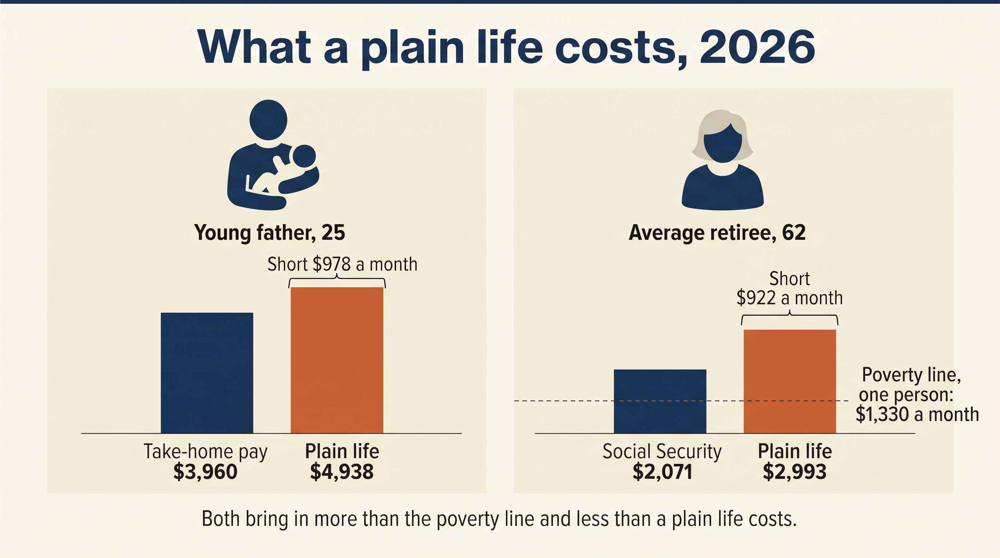

## Abstract

The author asks whether an ordinary American can afford a plain life in 2026 at the two ends of adult life: a young man who starts a household and a retiree who lives on Social Security. He builds worked cases from the public record, using federal pay, price and benefit tables, program rules and published surveys, and runs them through scripts that cite a source for every input. A 25-year-old father without a degree needs 125% of his take-home pay to cover rent, infant care, a car, food and health insurance. A woman who retires at 62 with the average check and the median retirement savings runs out of savings at 69, about 16 years short of the average life expectancy for a woman of 62. Both earn more than the official poverty line and less than a plain life costs them, and both earn just enough to fall outside most of the programs built to help people in their position. The retiree misses them by a few dollars a month. In the final chapter, the author gives his own argument about what these trends mean for the constitutional republic.

## Key findings

1. A father of one, 25 to 34, with a high school diploma and the median full-time pay of $51,430, needs 125% of his take-home pay to start a household; in Texas he needs 108% (Figure 2.1).
2. A woman who retires at 62 in 2026 with the average Social Security check and the median retirement savings of $86,900 runs out of savings at 69; a widow on the average survivor's check runs out at 68 (Figure 5.1).
3. At 62, the average woman can expect about 23 more years of life, so the average retiree lives about 16 years after her savings run out (Figure 10.1).
4. The average retired worker's check, $24,852 a year, clears the federal poverty guideline by about $9,000 and falls about $9,000 short of the Elder Index for a single renter (Figure 1.1).
5. A retiree with that check misses Extra Help with Medicare drug costs by $56 a month, Medicare premium help by $255 and Texas utility help by $76, while the food bank takes her (Figure 6.1).
6. A home cost 3.1 times the median household income in 1990 and 4.7 times in 2025, and 19.2% of men 25 to 34 live in a parent's home, against 10.5% in 1980 (Figures 3.1 and 3.2).
7. For every 100 never-married women 25 to 34, the country had 139 never-married men with a job in 1960 and 91 in 2012 (Figure 4.1).

---

# 1. The line

Federal statisticians still count the country's poor with a measure one economist built more than sixty years ago. In 1963 and 1964, Mollie Orshansky, an economist at the Social Security Administration, took the Department of Agriculture's economy food plan, the cheapest diet the department priced, and set a family's poverty threshold at three times its cost, as Gordon M. Fisher recounts in the *Social Security Bulletin*.1.1 The Office of Economic Opportunity adopted her figures as a working definition of poverty in May 1965, and in August 1969 the Bureau of the Budget directed every federal agency to use them as the official statistical measure.1.2

The people who wrote the food plan under the line attached a warning of their own. The Department of Agriculture designed the economy plan for "temporary or emergency use when funds are low," and the plan left out meals eaten away from home.1.3 Fisher quotes Orshansky's own caution: families spending at that level had "about 1 chance in 2 of getting a fair or better diet, but only 1 chance in 10 of getting a good diet".1.4

Census Bureau statisticians have updated the line each year for prices since 1969. The Census Bureau raises the thresholds by the Consumer Price Index and switched to the CPI-U, the index for all urban consumers, in 1979 or 1980.1.5 Its statisticians count money income before taxes, use one figure for the whole country, and leave out help such as Medicaid and food stamps. The Bureau itself calls the thresholds "a statistical yardstick, not as a complete description of what people and families need to live".1.6

Census Bureau statisticians put the line for an older American near $15,500 a year. For 2025, the Census Bureau set the threshold for one person 65 or older at $15,440.1.7 Federal agencies use a close cousin, the poverty guideline that the Department of Health and Human Services publishes, and for 2026 the department set it at $15,960 for one person.1.8 A single retiree with $16,000 a year stands above both lines, and the official count leaves her out of the poor.

By the official count, about one older American in ten lives in poverty. In 2025, 9.8% of Americans 65 and older fell under the line.1.9 The Bureau also publishes a fuller count, the Supplemental Poverty Measure, which subtracts taxes, medical bills and the expense of getting to work, and adjusts for what housing costs in each place. On that count, 15.4% of older Americans fell below the line, about five more people in every hundred.1.10

Researchers at the University of Massachusetts Boston priced a plain life directly. With their Elder Index, they add up what an older person needs where she lives: housing, food, health care, transportation and the other basics. By that measure, 53% of older adults living alone and 25% of couples take in less than the basics cost, up 5 and 4 points since 2022.1.11

The agencies that run the help programs draw their limits from the official line. To get SNAP, the federal food benefit paid on an EBT card, a Texan over 60 who lives alone must show net income of $1,330 a month or less for fiscal 2027, the poverty guideline itself.1.12 The Social Security Administration paid the average retired worker $2,071 a month in January 2026, about 160% of that guideline.1.13 The average retiree clears the official line by a wide margin, and by the Elder Index's count, more than half of older people living alone take in less than the basics cost.

You can measure the gap between the official line and the cost of a plain life in dollars. In the chapters ahead, you follow two people into it: a young man setting out to start a household, and a retiree trying to make savings last.

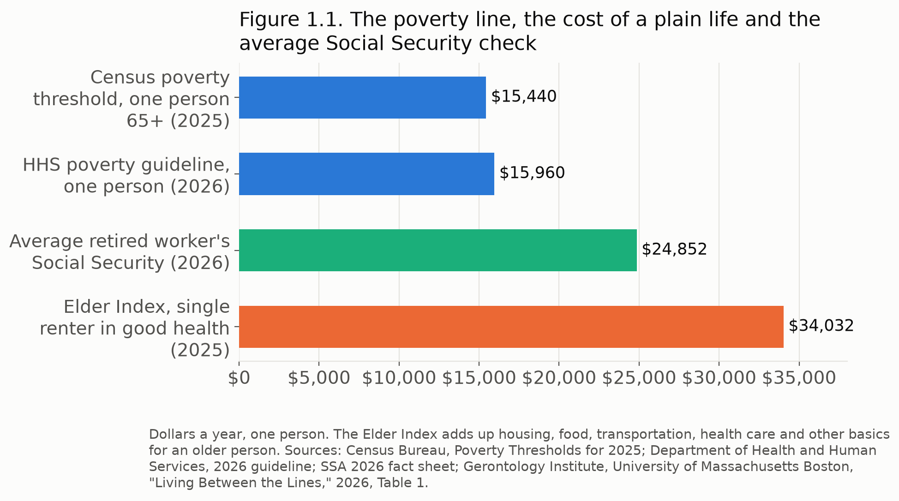

---

# 2. The young man's ledger

A 25-year-old man without a degree needs 125% of his take-home pay to start a household with one child, even after his tax credits. He earns $51,430 a year, takes home $3,960 a month once he claims his tax credits, and faces $4,938 in bills. Each month he comes up $978 short.

He earns what a typical young man with a high school diploma makes. The Census Bureau found that men 25 to 34 who finished high school and worked full time all year earned a median $51,430 in 2025, while men that age with a bachelor's degree or more earned $86,100.2.1 On $51,430, a single man owes $3,992 in federal income tax and $3,934 in Social Security and Medicare tax, and he keeps $3,625 a month.2.2 In Texas, he pays no state income tax.

Once he has a child, he can claim tax credits that raise what he keeps. When he files as head of household with one child, he claims the child tax credit and the child care credit and pays $0 in federal income tax, and the Internal Revenue Service sends him another $26 through the earned income tax credit, nearly phased out at his pay.2.3 He takes home $3,960 a month, $335 more than he kept as a single man.

He spends nearly half of that on rent before he buys anything else. He pays $1,806 a month for two bedrooms with utilities, the federal Fair Market Rent behind the National Low Income Housing Coalition's two-bedroom Housing Wage of $34.73 an hour.2.4 In Texas, he pays $1,557.2.5 To move in, he hands the landlord a typical deposit of $7952.6, which comes to $66 a month over his first year.

He spends another $859 to get to work and stay reachable. He makes a used-car payment of $542 a month, the national average.2.7 He pays $157 for car insurance and $102 for his phone, the averages for households headed by someone 25 to 34, and $58 for internet.2.8

He spends more on his child than on his car and his food together. He feeds himself and a one-year-old on the Agriculture Department's Thrifty plan, its lowest-cost budget, for $477 a month.2.9 He pays a child care center $1,303 a month to watch the baby while he works, the national average of $15,636 a year for infant care.2.10 In Texas, he pays $10,894 a year.2.11

He pays $427 for his own health insurance, and more for his child's. Under the Internal Revenue Service's 2026 rules for marketplace plans, he pays 9.96% of his income toward the benchmark silver plan, $427 a month at age 25, and the federal tax credit pays the other $64.2.12 At $4,286 a month before taxes, he earns more than Texas allows for Medicaid ($3,571 for a household of two) and for CHIP ($3,625) to cover the baby.2.13 He pays for the child's coverage on his own, and this ledger leaves that cost out, so the true total runs higher.

The bills come to $4,938 a month against $3,960 in pay. He spends 125% of what he brings home on rent, deposit, car, insurance, phone, internet, food, child care and his health plan. In Texas, where rent and child care cost less, he spends 108%. Living alone in a one-bedroom with no child, he spends $3,253 of his $3,625 and keeps $372.

He earns more than three times the poverty guideline for one person, and he still cannot start a family on that pay. The official line counts him far from poor. In the next chapter, the same arithmetic shows up across the country, in home prices, in the age of first-time buyers, and in the young men who stay with their parents.

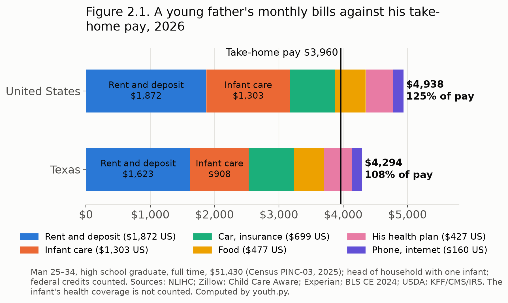

---

# 3. Starting later

Young Americans start their lives about a decade later than their parents did, and the public record shows why. They buy a first home later, marry later, have children later, and more of the young men stay with their parents. Across the country, the young man from the last chapter has company.

A home cost about three years of a household's income in the 1980s and nearly five in 2024. Alexander Hermann of the Harvard Joint Center for Housing Studies found that "price-to-income ratios nationally were remarkably stable between 1980 and 1999, when they fluctuated between 3.1 and 3.4," with 1988 at 3.2.3.1 His colleague Peyton Whitney reported that in 2024 "the national median single-family home price grew to five times the median household income," up from 4.1 in 2019.3.2 By September 2026, Realtors put the median existing home at $417,500, against $87,460 for the typical household the year before.3.3

The median first-time buyer grew a dozen years older. The National Association of Realtors reported that "the median age of first-time buyers is now 40. In the 1980s, the typical first-time home buyer was in their late 20s".3.4 First-time buyers made up 21% of purchases, a record low, against a norm of 40% before 2008.3.5 The Realtors called those who got in "the elite first-time buyers": 59% paid the down payment from savings and 26% from investments, and they named high rent and student loans as the costs that held them back from putting money aside.3.6

More young men live with their parents than in 1980. In 2025, 19.2% of men 25 to 34 and 13.6% of women that age lived in a parent's home, against 10.5% and 7.0% in 1980.3.7 The Pew Research Center set aside about one in five young men from its 2024 earnings study for that reason.3.8

Marriage and children come later, and for many, they never come. In 2021, a record 25% of 40-year-olds counted as never married, up from 6% in 1980.3.9 In 2024, American women had 1,599.5 births per 1,000 over a lifetime at that year's rates, a record low, and a mother had her first child at 27.6 on average, a record high.3.10

Fewer young men without a degree hold or seek work. In 1970, 98% of young men whose schooling ended with a high school diploma worked or looked for work; by 2013, 88% did, and today 87% do, the Pew Research Center found.3.11 Among men with some college, the share fell from 96% to 89%.3.12 The American Institute for Boys and Men, a research group, counted the share of men 16 to 24 out of school and out of the labor force at 4% in 1990 and 8% in 2024, and found that in 2024 two in three of them did not look for work.3.13

When men's work disappears, marriage follows it out. Economists David Autor, David Dorn and Gordon Hanson traced trade shocks that cut young men's factory jobs and pay, and found that marriage and births fell in those places while the share of children born to unwed mothers rose.3.14 Over the same years, young women pulled ahead in school: 47% of women 25 to 34 now hold a bachelor's degree, against 37% of men, where both stood at 25% in 1995.3.15 In the next chapter, you meet the young women on the other side of that gap, looking for a partner.

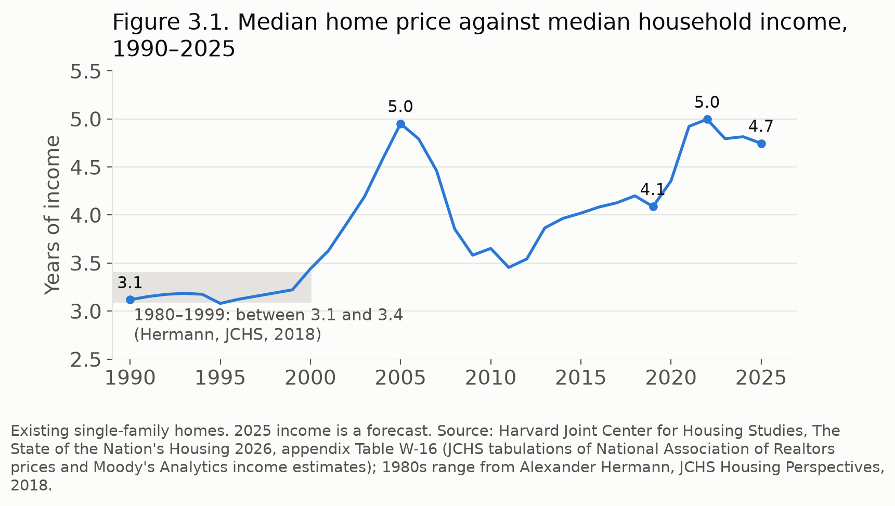

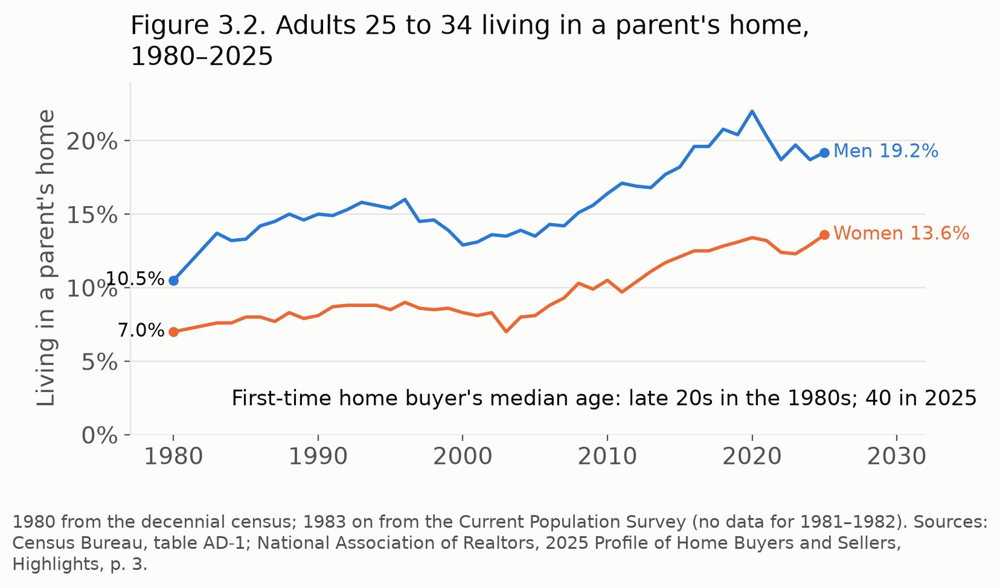

---

# 4. 91 men for every 100 women

In 2012, for every 100 never-married women between 25 and 34, the country had 91 never-married men that age with a job. In 1960, it had 139, the Pew Research Center found, even though young men outnumber young women overall.4.1 Pew put the result in one sentence: if every never-married young woman wanted a never-married young man with a job, "9% of them would fail, simply because there are not enough men in the target group."4.2

The shortage grows with a woman's schooling. Among never-married young adults with a high school education or less, Pew counted 174 men for every 100 women, but only 108 with a job.4.3 For every 100 never-married women with a college degree, Pew counted 88 employed men with one, and for women with a graduate degree, 67.4.4 Among never-married Black adults 25 to 34, Pew counted 92 men and 51 employed men for every 100 women; among white, Hispanic and Asian American young adults, the employed men and the women came out about even.4.5

Young women put a steady job first. In the same survey, 78% of never-married women called a steady job very important in a spouse, the top item on their list, while 46% of never-married men said so.4.6 In a later Pew survey, 71% of adults said a man has to support a family financially to make a good husband.4.7 Pew drew the line between the two findings itself: women "place a high premium on finding a spouse with a steady job," while "the changes in the labor market have contributed to a shrinking pool of available employed young men."4.8

Young women also pulled ahead in school. Today 47% of women 25 to 34 hold a bachelor's degree, against 37% of men.4.9 Pew found that men without a partner hold a degree less often than men with one (26% against 37%), hold a job less often (73% against 91%), and live in financial trouble far more often (36% against 13%).4.10 Among women, Pew found little difference between those with a partner and those without.4.11

The dating sites recorded the same pattern in what people did. Economists Günter Hitsch, Ali Hortaçsu and Dan Ariely studied a dating site and found that "women place about twice as much weight on income than men," while "men generally shy away from educated women."4.12 Researchers Bruch and Newman found that men wrote "more than 80% of first messages," that women answered fewer than one in five, and that more schooling always raised a man's appeal while a graduate degree lowered a woman's.4.13 Derek Kreager and colleagues found that "about 18% of men received no messages from women," while 98% of women heard from at least one man.4.14

Men and women on the apps describe opposite troubles. Of the men Pew surveyed who used dating apps, 64% felt insecure about how few messages they got, while 54% of the women felt overwhelmed by how many arrived.4.15 Women called a partner's listed occupation very important more than three times as often as men, 27% against 8%.4.16

One company runs many of the places where these choices happen. Match Group owns Tinder, Hinge, Match, OkCupid, Plenty of Fish and OurTime, along with BLK, Chispa, The League and others.4.17 The Federal Trade Commission stated in 2019 that Match Group "controls approximately 25 percent of the online dating market, which is more than twice the market share of its nearest competitor."4.18 In its latest annual report, the company told shareholders that demand "has softened among younger generations, particularly among women in those generations."4.19

Women in their 30s have children later, and more of them have none. The Census Bureau found 40% of women 30 to 34 childless in 2024, up from about 29% in 2014.4.20 Since 2016, women 30 to 34 have given birth at a higher rate than women 25 to 29, and in 2024 women 40 to 44 gave birth at their highest rate since 1965.4.21 In the federal government's 2024 health survey, 9.1% of women 30 to 39 without a partner said they felt lonely always or usually, against 3.4% of women with one, by our analysis of the survey's data.4.22

Young adults make choices of their own as well. Among young adults without children, 57% of men and 45% of women want them someday.4.23 Adults under 50 who expect to stay childless most often say they just don't want children (57%); 36% say they can't afford them, and 24% say they haven't found the right partner.4.24 Single women made up 25% of first-time home buyers, against 10% for single men,4.25 and unmarried mothers had 39.5% of the children born in 2024.4.26

Young men at the other end of the table report less intimacy and more loneliness. Peter Ueda and colleagues found that the share of men 18 to 24 who reported no sexual activity in the past year rose from 18.9% in 2000–02 to 30.9% in 2016–18, while women's share barely moved, and the rise came mostly among unmarried men with low pay or part-time or no work.4.27 Gallup found 25% of American men 15 to 34 felt lonely much of the previous day, against 18% of young women.4.28

A small number of these men call themselves "incels," short for involuntarily celibate. Researchers have no reliable count; estimates run from about 40,000 to a few hundred thousand in the United States4.29, out of roughly 20 million men 18 to 34. Researchers who surveyed 561 self-described incels in a study for the British government's Commission for Countering Extremism found poor mental health, with one in three thinking of suicide every day.4.30

Young men and young women now part ways in politics as well. In 2023, 40% of women 18 to 29 called themselves liberal, against 25% of men that age, the widest gap Gallup found in any age group.4.31 The young man from Chapter 2 and the young woman in this one want much the same life, and each finds the other harder to reach.

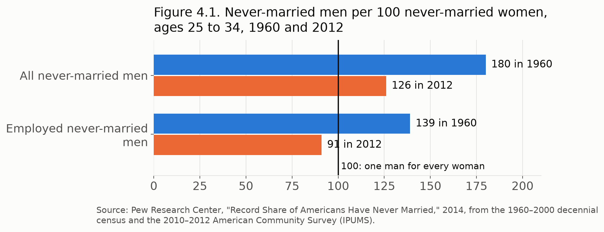

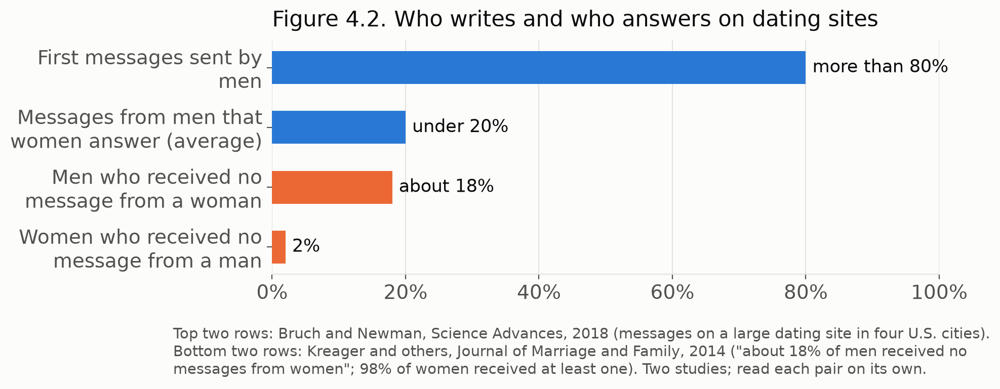

---

# 5. The retiree's ledger

The average American who retires at 62 in 2026 runs out of savings at 69. She draws the average Social Security check for a retired worker, $2,071 a month in January 20265.1, and she holds the median retirement savings of families that have an account, $86,900.5.2 Nearly half of families, about 46%, hold no retirement account.

She starts $922 short every month. She lives alone and pays the national median gross rent, $1,487 with utilities5.3, and makes a used-car payment of $542.5.4 She pays $89 for car insurance, $100 for gas and $46 for upkeep, $60 for her phone and $58 for internet, and $91 for doctor bills, drugs and supplies.5.5 She buys food on the Agriculture Department's low-cost plan for $2695.6 and spends $155 on clothing, personal care and household supplies.5.7 At full price, her marketplace health plan would cost $1,405 a month; after the tax credit, she pays $96. Her first month comes to $2,993 against $2,071 in benefits.

Four retirees with the same budget show who gets through the decade. A top earner, who paid Social Security tax on the maximum wage every year from age 22, draws $2,969 a month at 625.8 and still holds $56,450 at 71. The average retiree runs out at 69. A widow on the average survivor's check of $1,9195.9 runs out at 68. An average retiree with no retirement account falls short in her first month. The study's calculation script works out each year for all four from its cited sources.

At 65, she pays more for Medicare than for the plan she leaves behind. The Centers for Medicare & Medicaid Services set the Part B premium at $202.90 a month for 2026 and the Part D base premium at $38.99.5.10 One Texas insurer's 2026 filing prices a Medigap Plan G policy for a woman at $169 a month at 65, rising to $209 at 715.11, below the national average of $194 that the health policy research group KFF reported.5.12 She goes from $96 a month to $410, because she qualified for the marketplace credit based on her income and has no such credit under Medicare.

She gets a year's relief from car payments, then takes out a new loan. Experian puts the average used-car loan at 67.7 months, so her payments stop at 67.5.13 Her car, six years old when she bought it, reaches the average age of American cars, 12.8 years5.14, when she turns 68, and she takes a new loan at $637 a month.

Prices climb a little faster than her raises. From 2010 to 2024, the Bureau of Labor Statistics' price index for Americans 62 and older rose 2.73% a year, while the index that sets Social Security's raise rose 2.63%.5.15 Her food aid from Texas rises as her costs grow, from the $24 and then $25 minimum of SNAP, the federal food benefit, at 62 to about $186 a month by 715.16, enough to slow her losses but not to stop them.

Her savings fall away in seven years. She holds $76,132 after her first year, $40,141 after she turns 65, and $3,845 at the end of 68. By the end of 69, she has spent everything and runs $12,447 behind, and the shortfall grows by about $16,600 a year after that.

In the 1980s, the author of this study ran a retirement-planning firm that wrote plans for the clients of certified public accountants, and it used ten years as the safety period for a retirement. In 2026, that rule holds for the top earner alone. The average retiree's savings last seven years and the widow's six, and the retiree without an account starts short. A man of 62 can expect to live another 20 years and a woman another 235.17, so the average retiree in this ledger can expect to live more than a decade after her savings run out.

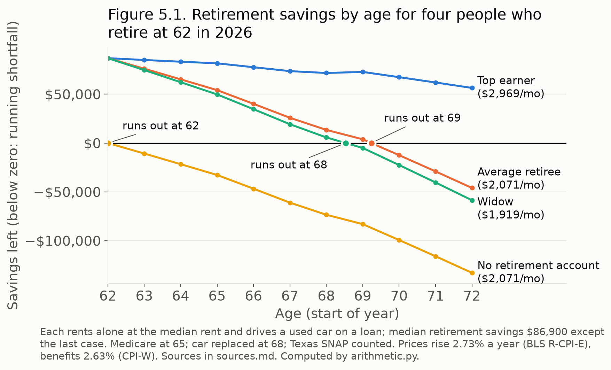

---

# 6. You are not poor enough for government help

You are not poor enough for government help. The average retiree and the young father earn just enough to fall outside the programs built for people in their position, often by a few dollars a month. The agencies that run these programs draw their limits from the federal poverty guideline, $15,960 a year for one person in 20266.1, and the Social Security Administration pays the average retired worker $2,071 a month, $24,852 a year.6.2 Her check clears the guideline and sits just above most of the limits that decide who gets help.

She qualifies for SNAP, the federal food benefit paid on an EBT card, at its smallest benefit. Under the Agriculture Department's rules, a household with someone 60 or older faces a net income test alone, deducts medical bills above $35 a month, and deducts housing costs without a cap.6.3 For the year that began October 1, 2026, the department set the net limit for one person at $1,330 a month, the standard deduction at $217, the minimum benefit at $25 and the maximum at $306.6.4 Once her rent and medical bills come off her income, she qualifies, and the department's formula gives her $25 a month.

She misses Extra Help by $56 a month. A person whose income stays under $23,940 a year, $1,995 a month, after the Social Security Administration sets aside the first $20, gets most of a drug plan's premiums and copays paid through Extra Help.6.5 Her $2,071, less the $20, comes to $2,051.

She misses help with her Medicare premium by $255 a month. The Medicare Savings Programs pay the $202.90 monthly Part B premium, and their highest tier, Qualifying Individual, stops at $1,816 a month with the $20 counted6.6; Texas lists the same limit as $1,796 before the $20.6.7 Medicare.gov still tells people, "Even if you don't think you qualify, you should still apply."

She misses help with her utility bills by $76 a month. The Texas Department of Housing and Community Affairs sets the limit for its Comprehensive Energy Assistance Program at $23,940 a year for one person, 150% of the guideline.6.8 Her $24,852 runs $912 a year over.

The food bank takes her. The Texas Department of Agriculture lets a person earning up to $29,526 a year, 185% of the guideline, receive groceries through the federal emergency food program from July 2026 through June 2027, and she qualifies with $4,674 to spare.6.9 Brian Greene, president of the Houston Food Bank, describes the people who come: "Food insecurity isn't really about food – it is about income. Food is simply the most flexible household expense when individuals or families lack the money to pay for fixed costs like rent, utilities and medical bills".6.10 The same food bank points out that SNAP supplies nine meals for every one the food banks hand out.6.11

Under the rules, she can lose even the small check. Under the 2025 federal law, the SNAP work requirement reaches adults up to 64, where it once stopped at 546.12: a covered adult who does not work, train or volunteer 80 hours a month keeps benefits for three months in three years, unless an exemption applies.6.13 A 62-year-old who retired early falls inside that age band. Her retirement account, at least, stays outside the count, since Congress excluded 401(k) plans and individual retirement accounts from SNAP's asset limit.6.14

The young father meets the same wall from the other side. He earns $4,286 a month before taxes, above the $3,571 Texas allows for Medicaid and the $3,625 it permits for CHIP, the Children's Health Insurance Program, in a household of two, so his baby qualifies for neither.6.15 He gets a $64 federal tax credit toward his own $491 health plan.

Against her $922 monthly shortfall, the help she qualifies for at 62 comes to $25 of SNAP and a place in the food bank line. Extra Help, Medicare premium help and utility aid would have covered hundreds of dollars a month, and each stops a few dollars below her check. The agencies that run these programs measure need with the same line Mollie Orshansky drew in 1963 and 1964, and the average retiree lives just above it.

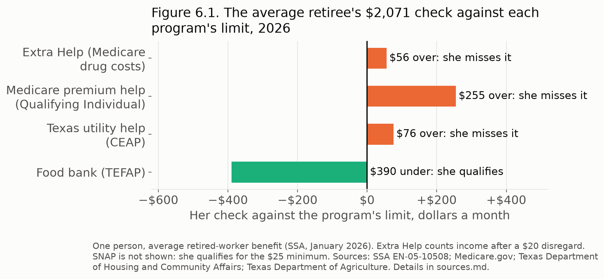

---

# 7. How people get by

Millions of Americans fill the gap between what they earn and what a plain life costs with side income, resale and the food bank. In 2024, one adult in five did gig work in the past month: 13% sold things for money in the gig or resale market, and 9% gave rides, delivered takeout or took odd jobs.7.1 Nearly a third of those workers, 31%, told the Federal Reserve they would have trouble making ends meet without that money.7.2

The young do most of it, and the old do more of it than most people guess. The Federal Reserve found gig work in the past month among 26% of adults 18 to 29, 24% of those 30 to 44, 21% of those 45 to 59, and 12% of those 60 and older.7.3 Our analysis of the Fed's public survey data finds the same slope for selling alone: 17.1% of adults under 30 sold things for money in the past month, and 7.4% of those 60 and older.7.4 Of the people who did gig work, 55% said it gave them flexibility; 35% said it gave them a balance between work and the rest of life.

Some retirees go back to work because they need the money. In 2025, 16% of retirees worked for pay in the previous month, and the Federal Reserve reported that "Five percent of retirees said that they worked because they needed money to make ends meet".7.5 Others work to keep their health coverage, and 74% of them had yet to reach 65, the age Medicare begins. Many never chose the date they stopped: health problems, caring for family or a lack of work set the timing for 42% of retirees, and for half of those with a high school education or less.7.6

Americans have built a resale economy out of what they already own. GlobalData, the research firm, projects the American market for secondhand clothing, counting online resale, consignment and thrift stores, at $78.8 billion by 2030.7.7 Americans selling what they already own feed a market that now runs in the tens of billions.

When the side money runs short, Texans turn to the food bank. Feeding America found 19.4% of Texans short of food in its 2024 data, up from 17.6% the year before: 6,062,890 people, the largest number in any state.7.8 Among Texans 60 and older, the share rose from 9.8% in 2022 to 13.6% in 2023 and 15.1% in 2024.7.9 Brian Greene, president of the Houston Food Bank, put the cause in one line: "Food insecurity isn't really about food – it is about income."

The food banks feed many people who earn too much for federal food aid. Across the country, "more than half of those struggling with food insecurity fall above the SNAP eligibility threshold, meaning many families must rely on local food banks and community meal programs to get by," the Houston Food Bank reported.7.10 The North Texas Food Bank handed out 116 million meals between July 2024 and June 2025, 14 million of them to seniors, in a region where one person in six faces hunger.7.11 Still, the food banks supply the smaller share: SNAP covers nine meals for every one they hand out.

Many people make their last stop at a church fellowship hall. Food banks stock local pantries, and churches run many of them, opening their doors on set days to anyone who meets the federal emergency food program's income limit, $29,526 a year for one person in Texas from July 2026 through June 2027.7.12 The average retiree from Chapter 5 qualifies there with room to spare, after Extra Help, Medicare premium help and utility aid each turned her away by a few dollars. On pantry day, she stands in line with families who earn too much for SNAP and too little for rent, food and the doctor.

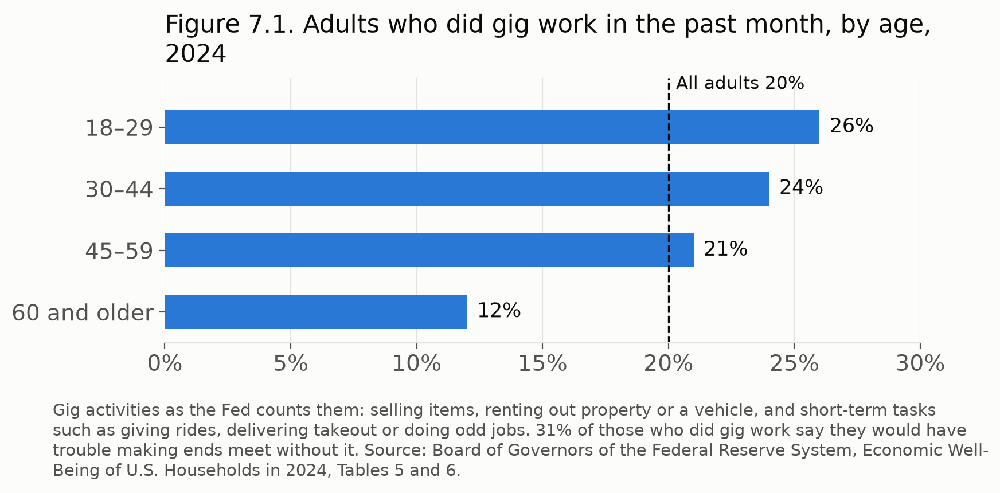

---

# 8. Work as the way in

A worker with a certification can find paid work without a degree, but employers have moved slower than their promises, and Texas has begun to change its own rules. The young father from Chapter 2 earns $51,430 as a high school graduate working full time, while a man his age with a bachelor's degree earns $86,100.8.1 He needs to know which doors open without one.

Computer support offers the widest door. The Bureau of Labor Statistics says candidates for support jobs "may qualify with a high school diploma plus relevant information technology (IT) certifications".8.2 Employers paid user support specialists a median $61,860 in May 2025 and network support specialists $76,220, from $10,000 to $25,000 more than the young father earns now. The bureau expects support employment to shrink 3% between 2025 and 2035, so he would enter a field that grows smaller.8.3

The better-paid systems jobs still ask for the degree. Network and computer systems administrators "typically need a bachelor's degree in a field related to computer or information science," the bureau reports, and employers paid them a median $99,130 in May 2025.8.4 The bureau projects a 4% decline in those jobs over the same decade.8.5

Many employers announced they would hire on skills, and few changed whom they hired. Researchers at Harvard Business School and the Burning Glass Institute followed firms that dropped degree requirements and found that "the increased opportunity promised by Skills-Based Hiring has borne out in not even 1 in 700 hires last year".8.6 They traced "nearly all of the change in actual hiring" to 37% of the firms that removed the requirement.8.7

Texas lawmakers chose to change the state's own payroll. The Texas Comptroller found that about 35% of state government jobs typically require a bachelor's degree, against about 28% of all nonfarm jobs in the state.8.8 The Legislature passed House Bill 3923, which took effect September 1, 2025, and directed the State Auditor's classification officer to reduce, where practicable, the number of state jobs that require a bachelor's degree.

The State Auditor's staff found that legislators wrote a degree requirement into law for few of those jobs. The State Classification Team reviewed 336 job classification series and found a degree requirement written into law or regulation for 31 of them.8.9 In another 72 series, agencies require a degree by their own policy and accept no substitute.8.10 In those 72, an agency can open the door by changing its own rule.

The retiree who wants to keep working meets a different limit. Until she reaches full retirement age, the Social Security Administration withholds $1 of her benefit for every $2 she earns above $24,480 a year.8.11 Even so, 16% of retirees worked for pay in the previous month in 2025, the Federal Reserve found.8.12 The young father and the retiree alike can cross the gap through work, and the people who write the rules on degrees and earnings decide how wide that way runs.

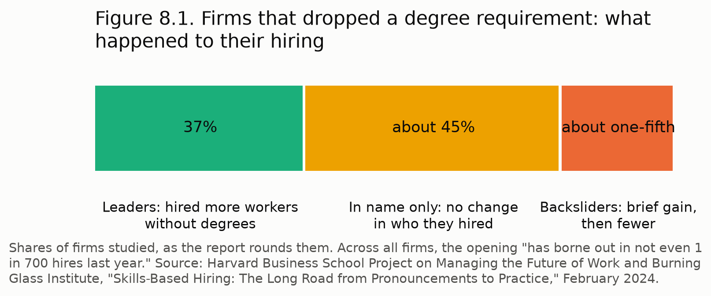

---

# 9. It has happened before

Americans have lived through an affordability squeeze before, and each fix moved the strain somewhere else. In 1980, Americans paid for it in prices and interest; in 2026, they pay for it in rent, child care and the years after work ends. In the 1980s, a remedy in one decade's law set up a bill in the next.

Prices and borrowing costs peaked in 1980. Consumer prices rose 14.8% in the twelve months to March 1980, by the Bureau of Labor Statistics' own index (69.8 in March 1979, 80.1 in March 1980), and the bureau reported that "consumer prices jumped 12.4 percent" over 1980 after a 13.3% rise in 1979.9.1 Banks charged their best customers a prime rate of 21.50% on December 19, 1980, and an average of 20.35% that month.9.2

Congress then rewrote the tax rules for real estate twice in five years. In the Economic Recovery Tax Act of 1981, Congress let an investor write off a commercial building over 15 years, where investors had to take 40 under earlier law, and the FDIC's worked example shows a top-bracket investor's after-tax return rising from 14.1% to 21.5%.9.3 The Comptroller of the Currency describes what followed: with the 1981 act, Congress gave investors "extraordinary, though temporary, incentives"; with a 1982 law, it let savings and loans make commercial real estate loans; and "these new laws helped fuel an explosion of speculative real estate lending that lasted until 1986, when the Tax Reform Act took away investor-friendly incentives".9.4

With the 1986 act, Congress took the investor's advantage away in one stroke. It lowered the top income tax rate from 50% to 38.5%, stretched the write-off for a commercial building to 31.5 years, and ended the right to set "tax losses" from "passive" real estate investments against other income.9.5 In the FDIC's example, the same investment's after-tax return fell back to 14.5%.9.6

The savings and loans paid for the reversal, and then taxpayers did. "Commercial real estate investment then ground to a halt—resulting in the savings and loan crisis," the Comptroller of the Currency records. "By 1988, about 250 thrifts with $81 billion in assets were technically insolvent."9.7 Congress abolished the main thrift regulator in 1989, and the Resolution Trust Corporation closed 747 savings and loans holding more than $407 billion in assets. Kenneth J. Robinson, writing for Federal Reserve History, puts the cost to taxpayers "as high as $124 billion"9.8; the FDIC counts "just over $160 billion, including $132 billion from federal taxpayers".9.9

Home prices held steady against income for twenty years, then climbed by half. The Harvard Joint Center for Housing Studies found that a home cost between 3.1 and 3.4 years of household income from 1980 through 19999.10 and nearly five years of income in 2024.9.11 A household that once needed three years of pay to match the price of a home now needs nearly five.

In 2026, Americans feel the strain in different places. A young father needs 125% of his take-home pay to start a household (Chapter 2). A family pays a child care center $15,636 a year for an infant.9.12 The median first-time home buyer has reached 40, where buyers in the 1980s bought in their late 20s.9.13 The average retiree runs out of savings at 69 (Chapter 5). The remedies of the 1980s changed where Americans feel the squeeze, and Americans still feel it.

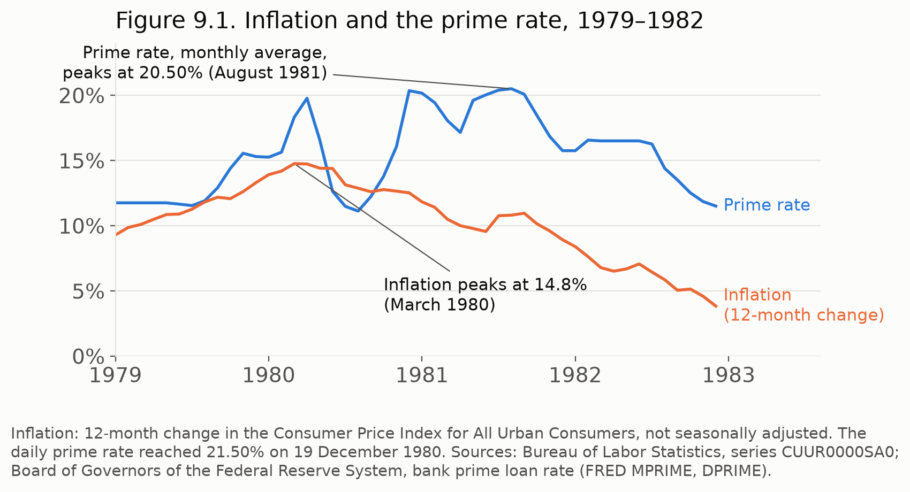

---

# 10. Longer lives, same money

Someone has to pay for every year added to a life, and anyone can read in a ledger where the money ends. The scientists and entrepreneurs who promise longer lives speak of biology; the retiree who lives those years pays for them in dollars.

David A. Sinclair, a Harvard Medical School scientist, states the promise plainly. In *Lifespan: Why We Age—and Why We Don't Have To*, he writes, "Or, put more simply and perhaps even more seditiously: aging itself is a disease".10.1 In a 2019 interview with Steve Hill of lifespan.io, an advocacy group that funded his lab, he said, "I think we know enough now about how aging works and how to slow it and possibly reverse it that it's going to be possible in our lifetimes to have a big impact on our healthspan and probably lifespan."10.2 Announcing a 2023 study in mice, he told Harvard Medical School, "we can drive it forwards and backwards at will."10.3

Peter Diamandis, an entrepreneur, extends the promise to decades. On his blog in May 2024, under the title "Longevity Escape Velocity: Nearing Immortality?", he wrote of a decade of converging technologies "with the promise of adding decades to our healthspan," and said he draws on his "annual Platinum Longevity Trips, my Moonshots podcast, and in consultation with the medical team at Fountain Life."10.4 A reviewer in *Family Medicine*, the journal of the Society of Teachers of Family Medicine, called the exercise and sleep chapters of his *Longevity Guidebook* "good, well-established information," and noted that the book "is a description of a medical practice he founded, Fountain Life."10.5

Federal actuaries already give a 62-year-old two decades. The Social Security Administration's actuaries expect a man of 62 to live another 20.29 years and a woman another 23.08, and at 65, another 18.12 and 20.66.10.6 A woman who retires at 62 can expect to reach about 85.

The money runs out long before the life does. The average retiree in Chapter 5 spends her last savings at 69, and the widow at 68. Set against the life table, the average retiree can expect to live about 16 years after her savings run out, and the widow about 17.

Each added year costs her more than she takes in. By 71, the average retiree in Chapter 5 falls about $17,000 a year short, and prices keep rising. If medicine added ten more years to her life, those years would take more than $170,000 she no longer holds, by the study's arithmetic.10.7 A longer life on the same check stretches the gap, year by year.

The years after the money ends can come alone. The U.S. Surgeon General's 2023 advisory reports that loneliness raises the risk of early death by 26% and social isolation by 29%, and that people with poor social connection face a 29% higher risk of heart disease and a 32% higher risk of stroke.10.8 Researchers at the University of Massachusetts Boston found that 53% of older adults who live alone already take in less than the basics cost.10.9

The numbers test the money, not the biology. Sinclair and Diamandis may prove right about the body. On the ledger, when Americans live longer without more retirement income, the average retiree gets more years to pay for and less to pay with.

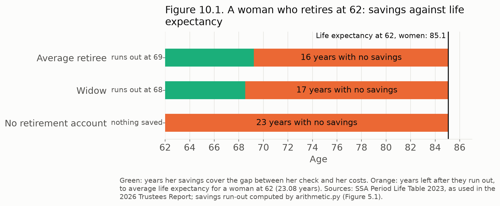

---

# 11. What would change it

*In this chapter, the author states his own argument. The chapters before it carry the evidence; here he says what he believes the evidence means.*

The United States has abandoned the Constitutional Republic, and the American dream has moved beyond our reach. I believe the trends in this study destroy that dream.

The United States is a constitutional republic. It is democratic, but it runs by a written Constitution, not by an unstructured government. The structure starts in the states. Each state has a legislature, a governor, a supreme court and lower courts; forty-nine of those legislatures have a house and a senate, and Nebraska's has one chamber. The voters of each state elect the senators and representatives who meet in Washington, and the electors each state appoints choose the President.

Many Americans could not describe that structure. In August 2026, 35% of adults could not name the three branches of government, and half could say what the Tenth Amendment reserves to the states.11.1 People who see the problems in their own lives and not the structure around them fall into widespread discord.

The Democratic Socialists of America, working through the Democratic Party, has written down how it would restructure the country. Its members run for office as Democrats, and in 2026 it published a program that would "abolish the Senate," "Replace the President and Supreme Court with an executive and judiciary chosen by and subordinate to Congress," "Abolish the Electoral College" and "Defund the Department of War," the Department of Defense under its second name.11.2 When reporters asked, Democratic senators turned down the Senate plank; Bernie Sanders answered "No."11.3

I believe the constitutional structure could fail under that agenda. Affordability shapes daily life, and the average American, uninformed about the structure, could vote in the people who wish to restructure the United States.

The Constitution sets a high bar for that agenda. Under Article V, two-thirds of both houses of Congress must propose an amendment, or Congress must call a convention at the request of two-thirds of the state legislatures, and three-fourths of the states, 38 of the 50, must ratify it. The same article provides that "no State, without its Consent, shall be deprived of its equal Suffrage in the Senate."11.4 Voters choose the members of Congress and of the state legislatures who would propose and ratify those amendments.

As I look back, we never solved these problems; they only changed shape. In 1980, inflation peaked at 14.8% and the prime rate reached 21.5% (Chapter 9). Congress changed the tax rules for real estate in 1981 and reversed them in 1986, and the decade closed with the savings and loan collapse and a bill to taxpayers of as much as $124 billion by Federal Reserve History's count11.5, or $132 billion by the FDIC's.11.6 A home cost three years of income then and nearly five now (Chapters 3 and 9). The squeeze moved from interest rates to rent, child care and the years after work ends.

I see affordability at the center of two problems in our society. The first falls on the elderly. When I wrote retirement plans in the 1980s, I used ten years as the safety period. Today the average retiree runs out of savings at 69 (Chapter 5), and a woman who retires at 62 can expect to live about 16 years after her money runs out (Chapter 10). She misses Extra Help by $56 a month, help with her Medicare premium by $255 and utility aid by $76 (Chapter 6). People live off eBay, thrift shops and side hustles like Facebook Marketplace, and more than half of the Americans who run short of food earn too much for SNAP (Chapter 7). Living longer brings its own losses: friends and family, the money to sustain a life, and the means of getting around.

The second problem falls on the young. Young people lack the education and training employers now pay for, and they marry and have children later, or never. A young father without a degree needs 125% of his take-home pay to start a household (Chapter 2). Inside that generation, young women hold the degrees and the jobs that come with them, and young men fall short of those women's standards for money, work and standing: in 2012 the country had 91 employed never-married men for every 100 never-married women between 25 and 34, and 78% of never-married women named a steady job as very important in a spouse (Chapter 4).

I want to answer both problems with work. For the young, I would open the job market with Linux and IT jobs, where a high school diploma plus certifications can qualify a worker for computer support paying a median of $61,860 to $76,220 (Chapter 8). Texas has started down that road: its Legislature told state agencies to cut degree requirements "to shift towards a skills-based hiring model to help strengthen the state workforce, improve recruitment, and promote upward mobility for all Texans"11.7, and 72 state job series still require a degree by agency policy alone. For older people, I would offer job opportunities and fair prices.

By fair prices I mean prices a fixed income can meet. They fail in three places. At 65, the average retiree's health coverage goes from $96 a month to $410, because she qualified for the marketplace credit based on her income and has no such credit under Medicare (Chapter 5). She misses Extra Help, help with her Medicare premium and utility aid by $56, $255 and $76 a month (Chapter 6). Members of Congress and agency officials set those prices and those limits, and they can change them. Employers can give older people the work that pays the difference.

These trends invite a radical change in the American experiment, and I warn against it. The change they invite is the restructuring that agenda describes, and each household that falls short of food or rent brings it closer.

I believe a person's current needs and desires trip the dopamine wire. If I need food or money, that need occupies my arousal, and I give it the attention a free citizen would give to everything else. A voter in that state hears the promise of food or money before hearing what the promise would cost the Constitution.

---

# Methods

We built the study's central numbers as worked cases: one household, one year of prices and one set of rules, run forward by a script. Each input in a script names the document and page it came from, and the source list gives every document with its page. The figures redraw from the same scripts whenever an input changes.

## The young father

We gave the young father the median pay of a man 25 to 34 with a high school diploma who works full time, all year: $51,430 (Census Bureau, table PINC-03, 2025 earnings). He rents a two-bedroom home at the federal Fair Market Rent behind the National Low Income Housing Coalition's Housing Wage, $1,806 a month nationally and $1,557 in Texas, and puts one infant in center care at Child Care Aware of America's average, $15,636 a year nationally and $10,894 in Texas. He makes the national average used-car payment (Experian), buys a benchmark marketplace health plan for himself after the federal credit, feeds the household on the Department of Agriculture's Thrifty plan, and pays car insurance, phone and internet at the Consumer Expenditure Survey's 2024 amounts. We spread a $795 security deposit over his first year (Zillow, as cited by the Harvard Joint Center for Housing Studies).

We filed him as head of household with one child and applied the 2026 standard deduction and brackets, payroll tax, the child tax credit, the earned income credit and the child care credit. His take-home pay comes to $3,960 a month. We left out the infant's health coverage: his pay runs above the Texas limits for Medicaid and CHIP, and a family marketplace plan would add to his costs.

## The retirees

We followed a single renter who retires at 62 in January 2026 and lives for ten years on Social Security and savings. Four cases differ only in the check and the savings: the maximum benefit at 62 ($2,969 a month), the average retired worker ($2,071), the average aged widow living alone ($1,919), and the average retired worker with no retirement account. The first three start with $86,900, the median retirement account among families that hold one (Federal Reserve, Survey of Consumer Finances 2022); about 46% of families hold none.

Each pays the national median gross rent with utilities, $1,487 (Census Bureau, American Community Survey 2024), and makes a used-car payment until the loan ends, then buys a replacement car at 68. Food follows the Department of Agriculture's low-cost plan for a woman 51 to 70. Car insurance, gasoline, upkeep, phone, out-of-pocket health costs, clothing, personal care and household supplies come from the 2024 Consumer Expenditure Survey for households headed by someone 55 to 64, divided by that household's 2.2 people or 2.1 vehicles. Until 65 she buys a benchmark silver marketplace plan with the federal credit. From 65 she pays the Medicare Part B and Part D premiums and a Medigap Plan G policy priced from one Texas insurer's 2026 filing for a woman. We counted Texas SNAP at the fiscal 2026 and 2027 amounts, with the deductions a household with a member 60 or older can claim under the rules.

## Growth rates

Prices in the retiree cases rise 2.73% a year, the 2010 to 2024 average of the Bureau of Labor Statistics research index for Americans 62 and older (R-CPI-E). Benefits rise 2.63% a year, the average of CPI-W, the index behind Social Security's yearly raise, over the same years. The bureau calls R-CPI-E a research index whose conclusions "should be treated as tentative."

## What the scripts leave out

Savings earn no return in the scripts, and we charged no income tax on the retiree's benefit or withdrawals. A return on savings would push each run-out age later; a tax would pull it earlier. The cases own no home, take no help from family, and earn nothing after they retire; Chapter 7 describes how many people fill the gap with side income instead. The program limits in Chapter 6 come from federal rules and from Texas, and other states set some of them differently.

## Survey analysis

For Chapter 7 we tabulated the Federal Reserve's 2024 Survey of Household Economics and Decisionmaking public file. We counted the share of adults who answered yes to question GE2A, which asks whether they made money in the past month by selling items at flea markets, garage sales or online marketplaces, and weighted each answer with the survey's own sample weight. Across all adults the script returns 13.1%, which matches the 13% the Federal Reserve published, and by age it returns 17.1% for adults 18 to 29 and 7.4% for those 60 and older.

## Other sources

We also drew on published reports from the Census Bureau, the Bureau of Labor Statistics, the Pew Research Center, the Harvard Joint Center for Housing Studies, the Federal Reserve, the Social Security Administration, the Gerontology Institute at the University of Massachusetts Boston, peer-reviewed studies, and state agencies in Texas. Where we relied on a company's own survey or a trade association, we say so in the endnote. We make no claim of peer review.

---

# Endnotes

## 1. The line

1.1. Gordon M. Fisher, *The Development and History of the Poverty Thresholds*, Social Security Bulletin 55, no. 4, Winter 1992, p. 3 (Orshansky developed the thresholds in 1963–64; PDF p. 1) and p. 5 ("three times the cost of the economy food plan"; PDF p. 3). src/gaps-a/a01-ssa-fisher-1992-poverty-thresholds.pdf.

1.2. Gordon M. Fisher, *The Development and History of the Poverty Thresholds*, Social Security Bulletin 55, no. 4, Winter 1992, p. 4 (adopted by the Office of Economic Opportunity in May 1965; official statistical definition in August 1969; PDF p. 2). src/gaps-a/a01-ssa-fisher-1992-poverty-thresholds.pdf.

1.3. Gordon M. Fisher, *The Development and History of the Poverty Thresholds*, Social Security Bulletin 55, no. 4, Winter 1992, p. 4 (economy plan for "temporary or emergency use when funds are low"; food eaten away from home left out; PDF p. 2). src/gaps-a/a01-ssa-fisher-1992-poverty-thresholds.pdf.

1.4. Same as 1.3.

1.5. Gordon M. Fisher, *The Development and History of the Poverty Thresholds*, Social Security Bulletin 55, no. 4, Winter 1992, p. 8 (annual price adjustment by the Consumer Price Index; PDF p. 6) and p. 10 (the CPI-U; PDF p. 8). src/gaps-a/a01-ssa-fisher-1992-poverty-thresholds.pdf.

1.6. U.S. Census Bureau, *How the Census Bureau Measures Poverty* (web page), last revised January 13, 2026, text line 292. src/gaps-a/a02-census-how-poverty-measured.txt.

1.7. U.S. Census Bureau, *Poverty Thresholds for 2025 by Size of Family and Number of Related Children Under 18 Years* (table), 2026, row 10, "65 years and over," $15,440. src/gaps-a/a03-census-thresh25.xlsx.

1.8. U.S. Department of Health and Human Services, Office of the Assistant Secretary for Planning and Evaluation, *2026 Poverty Guidelines* (web page), 2026, table "2026 Poverty Guidelines for the 48 Contiguous States and the District of Columbia," one person, $15,960; text line 71. src/gaps-a/a06-aspe-poverty-guidelines-2026.txt.

1.9. U.S. Census Bureau, Christina Bijou and Emily A. Shrider, *Poverty in the United States: 2025*, Current Population Reports P60-290, September 2026, Figure 2, "65 years and older," 9.8%, p. 4 (PDF p. 10). src/gaps-a/a07-census-p60-290-poverty-2025.pdf.

1.10. U.S. Census Bureau, Christina Bijou and Emily A. Shrider, *Poverty in the United States: 2025*, Current Population Reports P60-290, September 2026, Figure 3 (Supplemental Poverty Measure), "65 years and older," 15.4%, p. 5 (PDF p. 11). src/gaps-a/a07-census-p60-290-poverty-2025.pdf.

1.11. Caitlin E. Coyle, Michelle Ward, Nidya Velasco Roldán, Ceara Somerville and Jan Mutchler, *Living Between the Lines: Economic Insecurity and Older Americans*, UMass Boston Gerontology Institute, February 2026, abstract, PDF p. 3; body, PDF p. 8. src/primary/07d-elder-index-2026-full.pdf.

1.12. U.S. Department of Agriculture, Food and Nutrition Service, *SNAP – Fiscal Year 2027 Cost-of-Living Adjustments* (memorandum), August 21, 2026, p. 3 of 7, "Net Monthly Income Eligibility Standards (100 Percent of Poverty Level)," household size 1, 48 States and D.C., $1,330. src/primary/01e-fna-snap-cola-fy27-memo.pdf.

1.13. Social Security Administration, *2026 Social Security Changes* (fact sheet), October 2025, p. 1, "Estimated Average Monthly Social Security Benefits Payable in January 2026," All Retired Workers, after the 2.8% COLA, $2,071. src/arith/ssa-2026-cola-factsheet.txt, line 47.

## 2. The young man's ledger

2.1. U.S. Census Bureau, *PINC-03. Educational Attainment—People 18 Years Old and Over by Total Money Earnings in 2025, Work Experience in 2025, Age, Race, Hispanic Origin, and Sex* (table; Current Population Survey, 2026 Annual Social and Economic Supplement), 2026, sheet Male, 25 to 34 Years, Worked Full-Time, Year-Round, All Races, row 58, "Median earnings": high school graduate $51,430; bachelor's degree or more $86,100. src/youth/raw/pinc03/pinc03_2_5_2_1.xlsx.

2.2. Internal Revenue Service, *Rev. Proc. 2025-32* (2026 inflation adjustments), October 2025, Table 3 (unmarried individuals), p. 11, and sec. 4.14(1), standard deduction $16,100, p. 18. src/youth/raw/y15-irs-rp-25-32-2026-inflation.pdf. The 7.65% Social Security and Medicare rate: Social Security Administration, *2026 Social Security Changes* (fact sheet), October 2025, p. 1. src/arith/ssa-2026-cola-factsheet.txt, line 47. Figures computed by youth.py.

2.3. Internal Revenue Service, *Rev. Proc. 2025-32* (2026 inflation adjustments), October 2025, Table 2 (heads of households), pp. 10–11; sec. 4.05, child tax credit $2,200, p. 14; sec. 4.06(1), earned income credit, maximum $4,427 for one child, p. 15; sec. 4.14(1), head-of-household standard deduction $24,150, p. 18. src/youth/raw/y15-irs-rp-25-32-2026-inflation.pdf. 26 U.S.C. § 21(a)(2), 35 percent, text line 80, and § 21(c), $3,000 for one qualifying individual, line 115 (Legal Information Institute, Cornell Law School), src/gaps-b/b03-26usc21-cornell.txt; 26 U.S.C. § 24(d) and (h)(5)–(6), refundable portion, lines 92 and 151–154, src/gaps-b/b05-26usc24-cornell.txt. Figures computed by youth.py.

2.4. National Low Income Housing Coalition, *Out of Reach 2026: The High Cost of Housing*, June 2026, national report, PDF p. 15: two-bedroom Housing Wage $34.73; Fair Market Rent "$1,806 for a" two-bedroom home. src/primary/06b-nlihc-oor-2026-national.pdf.

2.5. National Low Income Housing Coalition, *Out of Reach 2026: The High Cost of Housing*, June 2026, Texas state page, p. 85: "In Texas, the Fair Market Rent (FMR) for a two-bedroom apartment is $1,557." src/youth/raw/y03-nlihc-oor-2026-texas.pdf.

2.6. Zillow Research, *Renters: Results from the Zillow Consumer Housing Trends Report 2025* (web page), 2025, text line 277: "the typical security deposit reported in 2025 was $795." src/gaps-b/b06-zillow-chtr-2025-renters.txt. The same figure appears in Alexander Hermann and Elizabeth R. Jones, *From Deposits to Fees, Renters Struggle with Up-Front Costs*, Harvard Joint Center for Housing Studies, March 16, 2026, p. 1. src/primary/07a-jchs-upfront-costs.pdf.

2.7. Experian, *State of the Automotive Finance Market: Q2 2026* (slide deck), PDF p. 34, "Average loan monthly payment," used, 2026: $542. src/primary/09a-experian-safm-q2-2026.pdf (chart values are images; see 09a-experian-safm-q2-2026-slide34.png).

2.8. U.S. Bureau of Labor Statistics, *Consumer Expenditure Surveys, 2024*, Table 1300, "Age of reference person," 25–34 column: vehicle insurance mean $1,888 a year, cellular phone service mean $1,221 a year. src/youth/raw/y18-bls-cex-2024-age-of-reference-person.xlsx. Internet: Table 2500, all consumer units, "Computer information services (internet)," mean $697.90 a year, text lines 1884–1885. src/gaps-b/b07-bls-cex-2024-all-detail.txt.

2.9. U.S. Department of Agriculture, *Official USDA Thrifty Food Plan: U.S. Average, September 2026*, p. 1: male 20–50 years $319.00 a month, child 1 year $114.20; footnote 2: "2-person—add 10 percent." src/youth/raw/y16-usda-cost-of-food-sep2026-Thrifty.pdf.

2.10. Child Care Aware of America, *Child Care in America: 2025 Price & Supply* (web report), 2025, table "Method 1: Average of Averages," Infants, Center, $15,636 a year. src/youth/raw/y05-ccaoa-price-supply-2025.txt.

2.11. Child Care Aware of America, *Child Care in America: 2025 Price & Supply*, 2025, state map chart data, Texas, "Center, Infant," $10,894 a year. src/youth/raw/y05c-ccaoa-2025-infant-center-map-embed.html.

2.12. Internal Revenue Service, *Rev. Proc. 2025-25* (2026 applicable percentage table), July 2025, sec. .01, p. 3: 9.96% from 300% to 400% of poverty. src/youth/raw/y10-irs-rp-25-25.pdf. Centers for Medicare & Medicaid Services, *State Specific Age Curve Variations*, August 9, 2013, p. 1, default curve: age 25, 1.004; age 40, 1.278. src/youth/raw/y13-cms-age-curve-variations.pdf. KFF, State Health Facts, *Average Monthly Marketplace Premiums by Metal Tier*, 2026: United States, average benchmark premium $625, the "second-lowest-cost silver (benchmark) premium for a 40-year-old." src/primary/09i-kff-avg-marketplace-premiums-2026.txt, lines 249, 407.

2.13. Texas Health and Human Services Commission, *Texas Works Handbook*, C-131.1, "Federal Poverty Level (FPL)," Revision 26-2, effective April 1, 2026: family size 2, 198% FPL, $3,571 a month (text line 74); 201% FPL (CHIP, TA 84), $3,625 (line 103). src/gaps-b/b01-tx-twh-c130-medical.txt.

## 3. Starting later

3.1. Alexander Hermann, *Price-to-Income Ratios are Nearing Historic Highs*, Harvard Joint Center for Housing Studies, Housing Perspectives, September 13, 2018 (web page): "price-to-income ratios nationally were remarkably stable between 1980 and 1999, when they fluctuated between 3.1 and 3.4"; "1988, when it was 3.2." src/youth/jchs/price-to-income-ratios-are-nearing-historic-highs.txt.

3.2. Peyton Whitney, *Home Prices Surge to Five Times Median Income, Nearing Historic Highs*, Harvard Joint Center for Housing Studies, Housing Perspectives, October 6, 2025 (web page): "five times the median household income in 2024"; "the 4.1 seen in 2019." src/youth/jchs/home-prices-surge-five-times-median-income-nearing-historic-highs.txt. The same ratios: Harvard Joint Center for Housing Studies, *The State of the Nation's Housing 2025*, p. 11 (PDF p. 13), Figure 6. src/primary/07e-jchs-son-2025.pdf.

3.3. National Association of Realtors, *Existing-Home Sales Increased 1.5% in September, According to NAR Report* (news release), October 13, 2026: "The median existing-home price for all housing types was $417,500." src/youth/raw/y07-nar-ehs-sep-2026.txt. U.S. Census Bureau, Melissa Kollar and Zach Scherer, *Income in the United States: 2025*, Current Population Reports P60-289, September 2026, p. 1 (PDF p. 7), and Figure 1, p. 2 (PDF p. 8): median household income $87,460. src/youth/raw/y08-census-p60-289-income-2025.pdf.

3.4. National Association of Realtors, *2025 Profile of Home Buyers and Sellers*, November 2025, Introduction, p. 3: "The median age of first-time buyers is now 40. In the 1980s, the typical first-time home buyer was in their late 20s." src/youth/raw/y06-nar-2025-profile-highlights.pdf.

3.5. National Association of Realtors, *2025 Profile of Home Buyers and Sellers*, November 2025, Introduction, p. 3: first-time buyers "a historic low of just 21 percent of all buyers"; "Prior to 2008, the share of first-time buyers had a historical norm of 40 percent." src/youth/raw/y06-nar-2025-profile-highlights.pdf.

3.6. National Association of Realtors, *2025 Profile of Home Buyers and Sellers*, November 2025, Introduction, p. 3: "Among the elite first-time buyers who can enter the market, they are most likely to use personal savings (59 percent) or financial assets (26 percent)"; high rent and student loans named as the "two foremost costs that hold them back from saving." src/youth/raw/y06-nar-2025-profile-highlights.pdf.

3.7. U.S. Census Bureau, *AD-1. Young Adults, 18-34 Years Old, Living At Home: 1960 to Present* (table), internet release December 2025, section "25 to 34 years," rows 2025 (men 19.2%, women 13.6%) and 1980 Census (men 10.5%, women 7.0%). src/youth/raw/y09b-census-ad1-table.xls.

3.8. Richard Fry, Dana Braga and Kim Parker, *Is College Worth It? 1. Labor market and economic trends for young adults*, Pew Research Center, May 23, 2024 (web page), section on household income: "we excluded young men who are living in their parents' home (about 20% of 25- to 34-year-old men in 2023)." src/youth/raw/y01-pew-2024-labor-market-young-adults.txt.

3.9. Katherine Schaeffer, *Striking findings from 2023*, Pew Research Center, December 8, 2023 (web page): "As of 2021, a quarter of 40-year-olds had never been married – up from 6% in 1980." src/04-pew-2023-striking-findings.txt.

3.10. Michelle J.K. Osterman, Brady E. Hamilton, Joyce A. Martin, Anne K. Driscoll and Claudia P. Valenzuela, *Births: Final Data for 2024*, National Vital Statistics Reports 75, no. 2, Centers for Disease Control and Prevention, June 9, 2026, p. 1 (abstract: total fertility rate 1,599.5 births per 1,000 women, a record low) and PDF p. 5 ("The mean age of mothers at first birth was a record high in 2024, 27.6 years"). src/05-cdc-nvsr75-02-births-2024.pdf.

3.11. Richard Fry, Dana Braga and Kim Parker, *Is College Worth It? 1. Labor market and economic trends for young adults*, Pew Research Center, May 23, 2024 (web page), section "Labor force participation": 98% in 1970, 88% in 2013, 87% today, for young men with a high school diploma. src/youth/raw/y01-pew-2024-labor-market-young-adults.txt.

3.12. Richard Fry, Dana Braga and Kim Parker, *Is College Worth It? 1. Labor market and economic trends for young adults*, Pew Research Center, May 23, 2024 (web page), section "Labor force participation": "96% of young men whose highest attainment was some college education were in the labor force in 1970. Today, the share is 89%." src/youth/raw/y01-pew-2024-labor-market-young-adults.txt.

3.13. Ravan Hawrami and Richard V. Reeves, *A generation of lost men? The reality of NEET data*, American Institute for Boys and Men, May 21, 2025 (web page), summary ("from 4% in 1990 to 8% in 2024") and text at Figure 3 ("by 2024, two-in-three" male NEETs not seeking work). src/06-aibm-neet.txt.

3.14. David Autor, David Dorn and Gordon Hanson, "When Work Disappears: Manufacturing Decline and the Falling Marriage Market Value of Young Men," *American Economic Review: Insights* 1, no. 2 (2019): 161–78, abstract, p. 161: "shocks to males' relative earnings reduce marriage and fertility." src/primary/09h-autor-dorn-hanson-2019-aeri-published.pdf, PDF p. 1.

3.15. Pew Research Center, *U.S. women are outpacing men in college completion, including in every major racial and ethnic group*, November 18, 2024 (web page): "Today, 47% of U.S. women ages 25 to 34 have a bachelor's degree, compared with 37% of men"; both "from 25%" in 1995. src/01-pew-2024-college-gap.txt.

## 4. 91 men for every 100 women

4.1. Pew Research Center (Wendy Wang and Kim Parker), *Record Share of Americans Have Never Married*, 24 September 2014, PDF p. 8 (printed p. 7): 139 employed never-married men per 100 never-married women ages 25 to 34 in 1960, 91 in 2012. src/02-pew-2014-never-married.pdf.

4.2. Same as 4.1.

4.3. Pew Research Center, *Record Share of Americans Have Never Married*, 24 September 2014, PDF p. 33 (printed p. 32): "174 men, but only 108 employed" per 100 women among those with a high school education or less. src/02-pew-2014-never-married.pdf.

4.4. Pew Research Center, *Record Share of Americans Have Never Married*, 24 September 2014, PDF p. 34 (printed p. 33), text and chart: 88 employed men per 100 women with a bachelor's degree, 67 with a post-graduate degree. src/02-pew-2014-never-married.pdf.

4.5. Pew Research Center, *Record Share of Americans Have Never Married*, 24 September 2014, PDF p. 15 (printed p. 14): 92 never-married black men and 51 employed black men per 100 black women ages 25 to 34. src/02-pew-2014-never-married.pdf.

4.6. Pew Research Center, *Record Share of Americans Have Never Married*, 24 September 2014, PDF p. 7 (printed p. 6), text and chart: "fully 78% say this would be very important"; men 46%. src/02-pew-2014-never-married.pdf.

4.7. Pew Research Center (Kim Parker and Renee Stepler), *Americans See Men as the Financial Providers, Even as Women's Contributions Grow*, 20 September 2017, paragraph beginning "Roughly seven-in-ten adults (71%)," txt line 56. src/03-pew-2017-men-providers.html.

4.8. Same as 4.1.

4.9. Pew Research Center (Kiley Hurst), *U.S. Women Are Outpacing Men in College Completion, Including in Every Major Racial and Ethnic Group*, 18 November 2024, txt line 58: "Today, 47% of U.S. women ages 25 to 34 have a bachelor's degree, compared with 37% of men." src/01-pew-2024-college-gap.html.

4.10. Pew Research Center (Richard Fry and Kim Parker), *Rising Share of U.S. Adults Are Living Without a Spouse or Partner*, 5 October 2021, txt lines 105 (degree, 26% against 37%), 110 (employed, 73% against 91%) and 113 (financially vulnerable, 36% against 13%). src/women/w06-pew-2021-living-without-partner.html.

4.11. Pew Research Center (Richard Fry and Kim Parker), *Rising Share of U.S. Adults Are Living Without a Spouse or Partner*, 5 October 2021, txt lines 105 and 113 (the women's figures beside the men's). src/women/w06-pew-2021-living-without-partner.html.

4.12. Günter J. Hitsch, Ali Hortaçsu and Dan Ariely, "Matching and Sorting in Online Dating," *American Economic Review* 100(1), March 2010, journal p. 148 (PDF p. 19). src/dating/d05-hitsch-hortacsu-ariely-2010-aer-matching-sorting.pdf.

4.13. Elizabeth E. Bruch and M. E. J. Newman, "Aspirational Pursuit of Mates in Online Dating Markets," *Science Advances* 4(8), eaap9815, 8 August 2018 (PubMed Central text): txt line 121 ("more than 80% of first messages are from men"; women's "average reply rate is less than 20%") and line 88 (education and desirability). src/dating/d03-bruch-newman-2018-sciadv-pmc.html.

4.14. Derek A. Kreager, Shannon E. Cavanagh, John Yen and Mo Yu, "'Where Have All the Good Men Gone?' Gendered Interactions in Online Dating," *Journal of Marriage and Family* 76(2), 2014, pp. 387–410 (PubMed Central author manuscript), txt line 45: 98% of women received at least one message; "about 18% of men received no messages from women." src/dating/d52-kreager-et-al-2014-jmf-good-men-gone-pmc.txt.

4.15. Pew Research Center (Emily A. Vogels and Colleen McClain), *Key Findings About Online Dating in the U.S.*, 2 February 2023, txt line 105. src/dating/d04-pew-2023-key-findings.html.

4.16. Pew Research Center (Monica Anderson, Emily A. Vogels and Erica Turner), *The Virtues and Downsides of Online Dating*, 6 February 2020, p. 25 (PDF p. 26): occupation, women 27%, men 8%. src/dating/d02-pew-2020-online-dating-report.pdf.

4.17. Match Group, Inc., *Form 10-K for the Fiscal Year 2025*, filed with the Securities and Exchange Commission 26 February 2026, Item 1, Business, txt lines 221–222 (Tinder, Hinge, Match, OkCupid, Plenty Of Fish, BLK), 316 (Chispa, The League) and 365 (OurTime). src/dating/d10-match-group-10k-fy2025.txt.

4.18. Federal Trade Commission, *Complaint for Permanent Injunction, Civil Penalties, and Other Relief*, FTC v. Match Group, Inc., Case 3:19-cv-02281-K, U.S. District Court for the Northern District of Texas, filed 25 September 2019, p. 3. src/dating/d60-ftc-2019-match-complaint.pdf.

4.19. Match Group, Inc., *Form 10-K for the Fiscal Year 2025*, filed with the Securities and Exchange Commission 26 February 2026, txt line 784. src/dating/d10-match-group-10k-fy2025.txt.

4.20. U.S. Census Bureau (Anita Li), *While Share of Younger Women Without Children Increased, More Women Had Children as They Entered Their Late 40s From 2014 to 2024*, America Counts, 23 September 2025, txt line 242: "about 40% of women ages 30 to 34 were childless in 2024, up from about 29% in 2014." The exact 2024 figure, 40.3%, is in Census, Current Population Survey Fertility Supplement, June 2024, Table 1. src/women/w12-census-2025-older-mothers.html; src/women/w14-census-cps-2024-fertility-t1.xlsx.

4.21. Centers for Disease Control and Prevention, National Center for Health Statistics, *Births: Final Data for 2024*, National Vital Statistics Reports vol. 75 no. 2, 9 June 2026, p. 4: rate at 30–34 above 25–29 "since 2016"; 40–44 "the highest rate since 1965." src/05-cdc-nvsr75-02-births-2024.pdf.

4.22. National Center for Health Statistics, National Health Interview Survey 2024, adult public-use file; weighted tabulation by this report, not a published table: women 30–39 without a partner 9.1% always or usually lonely, with a partner 3.4%. src/women/nhis2024/lonely-by-age-sex-output.txt, lines 21–22; script src/women/scripts/lonely.py; data src/women/nhis2024/adult24.csv.

4.23. Pew Research Center (Carolina Aragão), *Among Young Adults Without Children, Men Are More Likely Than Women to Say They Want to Be Parents Someday*, 15 February 2024, txt line 87. src/women/w05-pew-2024-young-adults-want-parents.html.

4.24. Pew Research Center (Rachel Minkin, Juliana Menasce Horowitz and Carolina Aragão), *The Experiences of U.S. Adults Who Don't Have Children*, 25 July 2024, txt lines 117 (just don't want to, 57%), 120 (can't afford, 36%) and 123 (haven't found the right partner, 24%). src/women/w04-pew-2024-adults-without-children.html.

4.25. National Association of Realtors, *2025 Profile of Home Buyers and Sellers* (highlights), PDF p. 4: "Among first-time buyers, 25 percent of buyers are single women and 10 percent are single men." NAR is a trade association. src/women/w15-nar-2025-home-buyer-seller-trends.pdf.

4.26. Centers for Disease Control and Prevention, National Center for Health Statistics, *Births: Final Data for 2024*, National Vital Statistics Reports vol. 75 no. 2, 9 June 2026, p. 6: births to unmarried women "39.5% in 2024." src/05-cdc-nvsr75-02-births-2024.pdf.

4.27. Peter Ueda, Catherine H. Mercer, Cyrus Ghaznavi and Debby Herbenick, "Trends in Frequency of Sexual Activity and Number of Sexual Partners Among Adults Aged 18 to 44 Years in the US, 2000-2018," *JAMA Network Open* 3(6), e203833, 12 June 2020, p. 1 (abstract). src/women/w11-ueda-2020-jama-sexual-inactivity.pdf.

4.28. Gallup (Benedict Vigers), *Younger Men in the U.S. Among the Loneliest in West*, 20 May 2025, txt line 281: 25% of U.S. men 15 to 34 lonely "a lot of the previous day," against "the total for young women (also 18%)." src/women/w02-gallup-2025-young-men-loneliest-west.html.

4.29. William Costello et al., "The Mating Psychology of Incels (Involuntary Celibates): Misfortunes, Misperceptions, and Misrepresentations," *The Journal of Sex Research*, September 2023, PDF p. 3: "from around 40,000 (Beauchamp, 2019) to hundreds of thousands (Kutchinsky, 2019)." src/women/w18-costello-buss-2023-mating-psychology-incels.pdf.

4.30. Joe Whittaker, William Costello and Andrew G. Thomas, *Predicting Harm Among Incels (Involuntary Celibates): The Roles of Mental Health, Ideological Belief and Social Networking*, study for the UK government's Commission for Countering Extremism, 2024, PDF p. 4 ("one in three incels contemplated suicide every day for the past two weeks") and PDF p. 5 (sample of 561). src/women/w17-whittaker-costello-thomas-2024-incels.pdf.

4.31. Gallup, *U.S. Women Have Become More Liberal; Men Mostly Stable*, 7 February 2024, txt line 297: the gap "is widest among those aged 18 to 29 (40% of women vs. 25% of men)." src/women/w08-gallup-2024-young-women-liberal.html.

## 5. The retiree's ledger

5.1. Social Security Administration, *2026 Cost-of-Living Adjustment (COLA) Fact Sheet*, October 2025, table "Estimated Average Monthly Social Security Benefits Payable in January 2026," All Retired Workers, after the 2.8% COLA, $2,071. src/arith/ssa-2026-cola-factsheet.html (text at src/arith/ssa-2026-cola-factsheet.txt, line 47).

5.2. Board of Governors of the Federal Reserve System, *Changes in U.S. Family Finances from 2019 to 2022: Evidence from the Survey of Consumer Finances*, Federal Reserve Bulletin, October 2023, table 3, PDF p. 21 (printed p. 15): retirement accounts held by 54.3% of families, conditional median $86,900 (text on PDF p. 22, printed p. 16). src/21-fed-scf-2022-bulletin.pdf.

5.3. Census Bureau, American Community Survey 2024 1-year estimates, table B25064, Median Gross Rent (Dollars), United States: $1,487, margin of error ±$3. src/primary/09c-census-acs2024-1yr-b25064.dat, line 2.

5.4. Experian, *State of the Automotive Finance Market: Q2 2026* (slide deck), PDF p. 34, "Average loan monthly payment," used, 2026: $542. src/primary/09a-experian-safm-q2-2026.pdf (chart values are images; see 09a-experian-safm-q2-2026-slide34.png).

5.5. Computed by arithmetic.py from Bureau of Labor Statistics, *Consumer Expenditure Surveys, 2024*, Table 1300, "Age of reference person," column 55–64, annual means: vehicle insurance $2,252, gasoline $2,522, maintenance and repairs $1,154, each divided by 2.1 vehicles; telephone services $1,596, medical services $1,352, drugs $794 and medical supplies $252, divided by 2.2 people; all divided by 12. src/arith/bls-ce-reference-person-age-ranges-2024.csv, lines 27, 31, 264, 431, 446, 456, 477, 482, 487. Internet: Bureau of Labor Statistics, *Consumer Expenditure Surveys, 2024*, Table 2500, "All consumer units," computer information services (internet), $697.90 a year, divided by 12. src/gaps-b/b07-bls-cex-2024-all-detail.txt, lines 1884–1885.

5.6. U.S. Department of Agriculture, *Official USDA Food Plans: Cost of Food at Home at Three Levels, U.S. Average, September 2026*, p. 1, low-cost plan, female 51–70 years, $268.90 a month. src/youth/raw/y16-usda-cost-of-food-sep2026-LowModLib.pdf.

5.7. Computed by arithmetic.py from Bureau of Labor Statistics, *Consumer Expenditure Surveys, 2024*, Table 1300, "Age of reference person," column 55–64, annual means: apparel and services $2,032, personal care products and services $1,023, housekeeping supplies $1,022, each divided by 2.2 people and by 12. src/arith/bls-ce-reference-person-age-ranges-2024.csv, lines 27, 299, 355, 529.

5.8. Social Security Administration, Office of the Chief Actuary, *Maximum-taxable benefit examples*, table row for retirement in January 2026, retirement at age 62, $2,969 a month. src/arith/ssa-oact-maximum-benefit.html (text at src/arith/ssa-oact-maximum-benefit.txt, lines 321–322; age-62 footnote, line 333).

5.9. Social Security Administration, *2026 Cost-of-Living Adjustment (COLA) Fact Sheet*, October 2025, table "Estimated Average Monthly Social Security Benefits Payable in January 2026," Aged Widow(er) Alone, after the 2.8% COLA, $1,919. src/arith/ssa-2026-cola-factsheet.html (text at src/arith/ssa-2026-cola-factsheet.txt, line 47).

5.10. Centers for Medicare & Medicaid Services, *2026 Medicare Parts A & B Premiums and Deductibles* (fact sheet), 14 Nov 2025: "The standard monthly premium for Medicare Part B enrollees will be $202.90 for 2026" (src/primary/09f-cms-2026-part-ab-premiums.txt, line 59); CMS, *2026 Medicare Part D Bid Information*, 28 Jul 2025: "For 2026, the base beneficiary premium will be $38.99" (src/primary/09g-cms-2026-part-d-bid-info.txt, line 48).

5.11. WPS Health Insurance (The EPIC Life Insurance Company), *Outline of Coverage: Medicare Supplement Insurance, Plans A, C, F, G, and N*, Texas, rates effective 1 January 2026, PDF p. 5, female table, Plan G: $2,022.12 a year at 65, $2,508.12 at 71 (monthly figures are these divided by 12). src/arith/wps-2026-medigap-tx.pdf.

5.12. Nancy Ochieng, Meredith Freed and Juliette Cubanski, KFF, *Key Facts About Medigap Enrollment and Premiums for Medicare Beneficiaries*, published 13 October 2026: Plan G average monthly premium among current policyholders in 2025, $194. src/primary/06-kff-medigap-key-facts.txt, lines 259, 282.

5.13. Experian, *State of the Automotive Finance Market: Q1 2026* (slide deck), PDF p. 35, "Average loan term," used, 2026: 67.73 months; the Q2 2026 deck gives 67.86 (p. 34). src/primary/09b-experian-safm-q1-2026.pdf (-slide35.png).

5.14. S&P Global Mobility, press release, 21 May 2025: "The average age of U.S. light vehicles rose to 12.8 years, an increase of two months for the second consecutive year in 2024." src/primary/09d-spglobal-vehicle-age-2025.txt, line 87.

5.15. Bureau of Labor Statistics, *Research consumer price index for Americans 62 years of age and older (R-CPI-E)*, Table 2, all items, annual average: 235.008 in 2010, 342.483 in 2024. src/primary/04-bls-r-cpi-e-data.xlsx (text at src/primary/04-bls-r-cpi-e-data.txt, lines 568, 582). Bureau of Labor Statistics, CPI-W, series CWUR0000SA0, annual average (M13): 213.967 in 2010, 307.552 in 2024. src/primary/04b-bls-cpi-w-cw.data.1.AllItems.txt, lines 3710, 3892. Yearly rates computed by arithmetic.py.

5.16. Computed by arithmetic.py from Texas Health and Human Services Commission, *MEPD and TW Bulletin 25-15*, 5 September 2025, PDF p. 5 (fiscal 2026 net income limit $1,305, standard deduction $209, minimum benefit $24), src/assist/texas-hhsc-bulletin-25-15-snap-fy2026.pdf; U.S. Department of Agriculture, Food and Nutrition Service, *SNAP – Fiscal Year 2027 Cost-of-Living Adjustments*, 21 August 2026, pp. 1–4 (minimum $25, standard deduction $217, net limit $1,330, maximum $306), src/primary/01e-fna-snap-cola-fy27-memo.pdf; and 7 CFR 273.9, rules for households with a member 60 or older, src/primary/01c-ecfr-7cfr-273.9.txt, lines 10, 148, 168.

5.17. Social Security Administration, Office of the Chief Actuary, *Actuarial Life Table: Period Life Table, 2023, as used in the 2026 Trustees Report*, row for exact age 62: life expectancy 20.29 years for men, 23.08 for women. src/gaps-b/b11-ssa-period-life-table.html (text at src/gaps-b/b11-ssa-period-life-table.txt, lines 521–527).

## 6. You are not poor enough for government help

6.1. U.S. Department of Health and Human Services, Office of the Assistant Secretary for Planning and Evaluation, *Poverty Guidelines*, table "2026 Poverty Guidelines for the 48 Contiguous States and the District of Columbia," one person, $15,960. src/gaps-a/a06-aspe-poverty-guidelines-2026.html (text at src/gaps-a/a06-aspe-poverty-guidelines-2026.txt, line 71).

6.2. Social Security Administration, *2026 Cost-of-Living Adjustment (COLA) Fact Sheet*, October 2025, table "Estimated Average Monthly Social Security Benefits Payable in January 2026," All Retired Workers, after the 2.8% COLA, $2,071 (the yearly figure is that times 12). src/arith/ssa-2026-cola-factsheet.html (text at src/arith/ssa-2026-cola-factsheet.txt, line 47).

6.3. 7 CFR 273.9, "Income and deductions": net income test alone for a household with a member 60 or older, §273.9(a); medical expenses above $35 a month, §273.9(d)(3); shelter deduction without a cap for such households, §273.9(d)(6)(ii). Electronic Code of Federal Regulations. src/primary/01c-ecfr-7cfr-273.9.txt, lines 10, 148, 168.

6.4. U.S. Department of Agriculture, Food and Nutrition Service, *SNAP – Fiscal Year 2027 Cost-of-Living Adjustments*, 21 August 2026: minimum benefit $25, p. 1; standard deduction $217, p. 2; net monthly income limit for one person $1,330, p. 3; maximum allotment for one person $306, p. 4. src/primary/01e-fna-snap-cola-fy27-memo.pdf.

6.5. Social Security Administration, *Understanding the Extra Help with Your Medicare Prescription Drug Plan*, publication 05-10508, August 2026, PDF p. 6 (printed p. 2): income limited to $23,940 a year for one person ($1,995 a month is that figure divided by 12). src/gaps-a/b05-ssa-pub-05-10508-extra-help.pdf. The $20 exclusion: Social Security Administration, POMS HI 03020.050, *Unearned Income Exclusions*: "The $20 per month general income exclusion applies to all unearned income including income based on need (IBON)." src/primary/09e-ssa-poms-hi03020050-unearned-exclusions.txt, line 39.

6.6. Medicare.gov, *Medicare Savings Programs*, 2026 monthly income limits, Qualifying Individual (QI) Program, individual, $1,816. src/gaps-a/b02-medicare-gov-msp.html (text at src/gaps-a/b02-medicare-gov-msp.txt, line 58).

6.7. Texas Health and Human Services Commission, *MEPD and TW Bulletin 26-04: 2026 Federal Poverty Level*, 19 February 2026, p. 2: Qualifying Individuals (QI-1), 135% FPL, individual, $1,796. src/gaps-a/b06-tx-hhsc-mepd-twh-bulletin-26-04.pdf.

6.8. Texas Department of Housing and Community Affairs, *Community Affairs Income Guidelines*, "Program Year 2026 Federal Poverty Income Guidelines (FPIG)," effective 26 January 2026: CEAP at 150% of FPIG, household of one, $23,940. src/gaps-a/b07-tdhca-community-affairs-income-guidelines.html (text at src/gaps-a/b07-tdhca-community-affairs-income-guidelines.txt, lines 96–106).

6.9. Texas Department of Agriculture, Square Meals, *Income Eligibility Guidelines*, TEFAP, effective 1 July 2026 – 30 June 2027, household of one, $29,526 a year, "based on 185% of the federal poverty guidelines." src/primary/03-tda-squaremeals-ieg-page.html (text at src/primary/03-tda-squaremeals-ieg-page.txt, lines 683–695, 748).

6.10. Houston Food Bank, *Map The Meal Gap: Food Insecurity In Texas Has Increased Exponentially*, press release, 29 July 2026, quoting Brian Greene, president/CEO, in the fifth paragraph. src/assist/houston-fb-mmg-2026-texas.html (text at src/assist/houston-fb-mmg-2026-texas.txt, a single line).

6.11. Houston Food Bank, *Map The Meal Gap: Food Insecurity In Texas Has Increased Exponentially*, press release, 29 July 2026: "for every meal provided by food banks, SNAP provides nine." src/assist/houston-fb-mmg-2026-texas.html (text at src/assist/houston-fb-mmg-2026-texas.txt, a single line).

6.12. Congressional Research Service, *Supplemental Nutrition Assistance Program (SNAP) and Related Nutrition Programs in P.L. 119-21: An Overview*, R48552, updated 23 July 2025, p. 6: the law "expands the population subject to the time limit to ages 18-64." src/primary/06a-crs-r48552-snap-pl119-21.pdf.

6.13. South Carolina Department of Social Services, *New Federal SNAP Work Requirements Take Effect in South Carolina*, release, 2 February 2026: adults 18–64 "must work or participate in work programs for at least 80 hours per month ... to retain SNAP eligibility beyond three months in a 36-month period." src/assist/sc-dss-snap-work-rules-2026.html (text at src/assist/sc-dss-snap-work-rules-2026.txt, a single line).

6.14. 7 U.S.C. 2014(g)(7), "Exclusion of retirement accounts from allowable financial resources," Legal Information Institute, Cornell Law School. src/primary/01d-7usc2014-cornell.txt, lines 339–344.

6.15. Texas Health and Human Services Commission, *Texas Works Handbook*, C-131.1, "Federal Poverty Level (FPL)," Revision 26-2, effective 1 April 2026, household of two: Medicaid for an infant (198% FPL) $3,571 a month; CHIP $3,625. src/gaps-b/b01-tx-twh-c130-medical.html (text at src/gaps-b/b01-tx-twh-c130-medical.txt, lines 74, 103).

## 7. How people get by

7.1. Board of Governors of the Federal Reserve System, *Economic Well-Being of U.S. Households in 2024*, May 2025, PDF p. 20 (printed p. 16), table 4 and text: 13% sold things and 9% did short-term tasks in the prior month; PDF p. 21 (printed p. 17), table 5: any gig activity, 20% overall. src/assist/fed-shed-2024-report.pdf.

7.2. Board of Governors of the Federal Reserve System, *Economic Well-Being of U.S. Households in 2024*, May 2025, PDF p. 22 (printed p. 18), table 6 and text: "Overall, 31 percent of people who did" gigs would have trouble making ends meet without the money. src/assist/fed-shed-2024-report.pdf.

7.3. Board of Governors of the Federal Reserve System, *Economic Well-Being of U.S. Households in 2024*, May 2025, PDF p. 21 (printed p. 17), table 5, "Share doing gig activities," by age: 18–29, 26%; 30–44, 24%; 45–59, 21%; 60+, 12%. src/assist/fed-shed-2024-report.pdf.

7.4. Computed by shed.py, a weighted tabulation of the Federal Reserve's Survey of Household Economics and Decisionmaking 2024 public data file (question GE2A, survey weight weight; not a Federal Reserve table): selling in the past month, 17.1% at 18–29, 7.4% at 60 and older, 13.1% of all adults against the Fed's published 13%. Output: shed-output.txt. Data: src/gaps-b/b10-shed-2024-csv/public2024.csv; codebook src/gaps-b/b09-fed-shed-2024-codebook.pdf.

7.5. Board of Governors of the Federal Reserve System, *Economic Well-Being of U.S. Households in 2025*, May 2026, PDF p. 24 (printed p. 20): 16% of retirees worked for pay in the previous month; PDF p. 25 (printed p. 21): "Five percent of retirees said that they worked because they needed money to make ends meet." src/gaps-b/b08-fed-shed-2025-report.pdf.

7.6. Board of Governors of the Federal Reserve System, *Economic Well-Being of U.S. Households in 2024*, May 2025, PDF p. 18 (printed p. 14): health problems, caring for family and lack of work "contributed to the timing of retirement for 42 percent of retirees"; "Half of retirees with a high school degree or less cited at least one of these reasons." src/assist/fed-shed-2024-report.pdf.

7.7. ThredUp, *ThredUp's 14th Annual Resale Report Reveals New Era of Structural Competition and AI-Driven Discovery*, press release, 2 April 2026, p. 1: GlobalData's Neil Saunders, "We expect the U.S. market alone to reach $78.8 billion by 2030." src/assist/thredup-2026-resale-ir.pdf.

7.8. Houston Food Bank, *Map The Meal Gap: Food Insecurity In Texas Has Increased Exponentially*, press release, 29 July 2026, releasing Feeding America's *Map the Meal Gap 2026* (2024 data): 19.4% of Texans, up from 17.6%; 6,062,890 Texans. src/assist/houston-fb-mmg-2026-texas.html (text at src/assist/houston-fb-mmg-2026-texas.txt, a single line).

7.9. Feeding America, *Map the Meal Gap*, "Senior Hunger & Poverty in Texas," food insecurity among Texans 60 and older: 15.1% in 2024 (2026 edition), 13.6% in 2023 (2025 edition), 9.8% in 2022 (2024 edition), page description. src/primary/05-feeding-america-mmg2026-tx-senior60-2024data.html; src/primary/05b-feeding-america-mmg2025-tx-senior60-2023data.html; src/primary/05c-feeding-america-mmg2024-tx-senior60-2022data.html.

7.10. Houston Food Bank, *Map The Meal Gap: Food Insecurity In Texas Has Increased Exponentially*, press release, 29 July 2026: "Across the country, more than half of those struggling with food insecurity fall above the SNAP eligibility threshold." src/assist/houston-fb-mmg-2026-texas.html (text at src/assist/houston-fb-mmg-2026-texas.txt, a single line).

7.11. North Texas Food Bank, *FY25 By the Numbers*, July 2024 – June 2025, p. 1: 116 million physical meals provided; 14 million meals provided to seniors; 1 in 6 North Texans face hunger. src/assist/ntfb-fy25-by-the-numbers.pdf.

7.12. Texas Department of Agriculture, Square Meals, *Income Eligibility Guidelines*, TEFAP, effective 1 July 2026 – 30 June 2027, household of one, $29,526 a year. src/primary/03-tda-squaremeals-ieg-page.html (text at src/primary/03-tda-squaremeals-ieg-page.txt, lines 683–695, 748).

## 8. Work as the way in

8.1. U.S. Census Bureau, *PINC-03. Educational Attainment—People 18 Years Old and Over by Total Money Earnings in 2025, Work Experience in 2025, Age, Race, Hispanic Origin, and Sex* (men 25 to 34, worked full-time, year-round), Current Population Survey, 2026 Annual Social and Economic Supplement, row 58, "Median earnings (dollars)": high school graduate $51,430; bachelor's degree or more $86,100. src/youth/raw/pinc03/pinc03_2_5_2_1.xlsx (text copy pinc03_2_5_2_1.txt, line 58).

8.2. U.S. Bureau of Labor Statistics, *Occupational Outlook Handbook*, "Computer Support Specialists," How to Become One, txt line 218; the median pay for user support ($61,860) and network support ($76,220) specialists in May 2025 is under Pay, txt line 220. src/18-bls-ooh-support-specialists.html (text copy .txt).

8.3. U.S. Bureau of Labor Statistics, *Occupational Outlook Handbook*, "Computer Support Specialists," Job Outlook: "projected to decline 3 percent from 2025 to 2035," txt line 222. src/18-bls-ooh-support-specialists.html.

8.4. U.S. Bureau of Labor Statistics, *Occupational Outlook Handbook*, "Network and Computer Systems Administrators," How to Become One, txt line 218 (bachelor's degree); Pay, txt line 220 ($99,130, May 2025). src/11-bls-ooh-sysadmin.html (text copy .txt).

8.5. U.S. Bureau of Labor Statistics, *Occupational Outlook Handbook*, "Network and Computer Systems Administrators," Job Outlook: "projected to decline 4 percent from 2025 to 2035," txt line 222. src/11-bls-ooh-sysadmin.html.

8.6. Harvard Business School Project on Managing the Future of Work and Burning Glass Institute, *Skills-Based Hiring: The Long Road from Pronouncements to Practice*, Joseph Fuller, 14 Feb 2024 (updated 28 May 2024), excerpt of the report quoted on the page, txt line 5. src/16-hbs-bgi-skills-based-hiring-2024.html (text copy .txt).

8.7. Same as 8.6.

8.8. Senate Research Center, *Bill Analysis, H.B. 3923* (89R, engrossed), 22 May 2025, Author's/Sponsor's Statement of Intent, txt lines 14–18 (35% and 28%); effective date 1 Sep 2025, Section 2, txt line 58. src/19-texas-hb3923-analysis.html (text copy .txt).

8.9. Texas State Auditor's Office, *A Report on Expanding State Job Opportunities for Individuals Without a Bachelor's Degree*, Report No. 26-705, July 2026, pp. 1–2 (336 series reviewed; 31 require a degree under law or regulation). src/20b-texas-sao-26-705.pdf.

8.10. Texas State Auditor's Office, *A Report on Expanding State Job Opportunities for Individuals Without a Bachelor's Degree*, Report No. 26-705, July 2026, p. 4 (72 additional series "without any substitution"; also summarized on p. 1). src/20b-texas-sao-26-705.pdf.

8.11. Social Security Administration, *Fact Sheet: 2026 Social Security Changes*, Retirement Earnings Test Exempt Amounts, under full retirement age $24,480 a year; "One dollar in benefits will be withheld for every $2 in earnings above the limit," txt line 47. src/arith/ssa-2026-cola-factsheet.html (text copy .txt).

8.12. Board of Governors of the Federal Reserve System, *Economic Well-Being of U.S. Households in 2025*, May 2026, PDF p. 24: "Sixteen percent of retirees also said that they had done some work for pay or profit in the previous month." src/gaps-b/b08-fed-shed-2025-report.pdf.

## 9. It has happened before

9.1. Craig Howell, Dave Callahan and others, U.S. Bureau of Labor Statistics, "Price changes in 1980: double-digit inflation persists," *Monthly Labor Review*, April 1981, PDF p. 1 ("Consumer prices jumped 12.4 percent"; CPI-U up 12.4 percent "following a 13.3-percent advance during 1979"). src/gaps-a/c01b-bls-mlr-1981-04-art1-prices-1980.pdf. The 14.8% rise to March 1980 is computed from BLS CPI-U series CUUR0000SA0, March 1979 69.8 and March 1980 80.1, src/gaps-a/c01-bls-api-cpiu-1979-1981.json.

9.2. Board of Governors of the Federal Reserve System, H.15 bank prime loan rate, via FRED: daily series DPRIME, 21.50 on 19 Dec 1980, src/gaps-a/c02b-fred-dprime-1980-82.csv, line 255; monthly series MPRIME, 20.35 for December 1980, src/gaps-a/c02-fred-mprime.csv, line 385.

9.3. Federal Deposit Insurance Corporation, *History of the Eighties—Lessons for the Future*, Vol. 1, *An Examination of the Banking Crises of the 1980s and Early 1990s*, ch. 3, "Commercial Real Estate and the Banking Crises," n.d., p. 140 (15 years against 40 under earlier law) and p. 163 ("14.1 percent versus 21.5 percent"; Table 3-A.2, p. 164). src/gaps-a/c06-fdic-history-eighties-v1-ch3-commercial-real-estate.pdf.

9.4. Office of the Comptroller of the Currency, *Evolution of Bank Supervision: 1980–1989*, n.d., txt line 183. src/gaps-a/c03-occ-evolution-bank-supervision-1980-1989.html (text copy .txt).

9.5. Federal Deposit Insurance Corporation, *History of the Eighties—Lessons for the Future*, Vol. 1, ch. 3, n.d., p. 141 (top rate 50 to 38.5 percent; "tax losses" from "passive" investments); the 31.5-year write-off appears in Table 3-A.1, p. 163, and on p. 165. src/gaps-a/c06-fdic-history-eighties-v1-ch3-commercial-real-estate.pdf.

9.6. Federal Deposit Insurance Corporation, *History of the Eighties—Lessons for the Future*, Vol. 1, ch. 3, n.d., Table 3-A.2, p. 164 (after-tax internal rate of return 14.5% after 1986), and p. 165. src/gaps-a/c06-fdic-history-eighties-v1-ch3-commercial-real-estate.pdf.

9.7. Office of the Comptroller of the Currency, *Evolution of Bank Supervision: 1980–1989*, n.d., txt line 184. src/gaps-a/c03-occ-evolution-bank-supervision-1980-1989.html (text copy .txt).

9.8. Kenneth J. Robinson, *Savings and Loan Crisis*, Federal Reserve History, n.d., txt line 57, which also carries the 1989 act, the abolished regulator, and the RTC's 747 closures with assets of over $407 billion. src/gaps-a/c04-fedhistory-savings-and-loan-crisis.html (text copy .txt).

9.9. Federal Deposit Insurance Corporation, *History of the Eighties—Lessons for the Future*, Vol. 1, ch. 4, "The Savings and Loan Crisis and Its Relationship to Banking," n.d., p. 187. src/gaps-a/c05-fdic-history-eighties-v1-ch4-sl-crisis.pdf.

9.10. Alexander Hermann, Joint Center for Housing Studies of Harvard University, *Price-to-Income Ratios are Nearing Historic Highs*, 13 Sep 2018: "price-to-income ratios nationally were remarkably stable between 1980 and 1999, when they fluctuated between 3.1 and 3.4" (web page, saved as a single line). src/youth/jchs/price-to-income-ratios-are-nearing-historic-highs.html (text copy .txt).

9.11. Joint Center for Housing Studies of Harvard University, *The State of the Nation's Housing 2025*, 2025, PDF p. 13 (printed p. 11): "In 2024, the price-to-income ratio hit 5.0"; Figure 6 note, PDF p. 12. src/primary/07e-jchs-son-2025.pdf.

9.12. Child Care Aware of America, *Child Care in America: 2025 Price & Supply*, 2025, Method 1, Average of Averages table: infants in a center, $15,636. src/youth/raw/y05-ccaoa-price-supply-2025.html (text copy .txt).

9.13. National Association of Realtors, *2025 Profile of Home Buyers and Sellers*, Highlights, 2025, p. 3: "The median age of first-time buyers is now 40. In the 1980s, the typical first-time home buyer was in their late 20s." src/youth/raw/y06-nar-2025-profile-highlights.pdf.

## 10. Longer lives, same money

10.1. David A. Sinclair with Matthew D. LaPlante, *Lifespan: Why We Age—and Why We Don't Have To*, Atria Books, 10 Sep 2019, p. 67 (Kindle edition, ASIN B07N4C6LGR, p. 97 of 538). No local file; read in Tom's Kindle library 19 Oct 2026; print page confirmed through Google Books (sources.md item 51).

10.2. Steve Hill, *David Sinclair on NMN and Epigenetics*, lifespan.io (Lifespan Research Institute), 10 Sep 2019, txt line 136. src/gaps-b/b13-lifespanio-2019-sinclair-interview.html (text copy .txt).

10.3. Harvard Medical School, news release on Sinclair's epigenetic aging study in mice, 12 Jan 2023, txt line 87. src/gaps-b/b12-hms-2023-sinclair-epigenetic-aging.html (text copy .txt).

10.4. Peter Diamandis, *Longevity Escape Velocity: Nearing Immortality?*, blog, 2 May 2024, txt lines 27 and 29. src/gaps-b/b14-diamandis-blog-longevity-escape-velocity.html (text copy .txt).

10.5. Joseph E. Scherger, review of Peter Diamandis, *Longevity Guidebook: How to Slow, Stop, and Reverse Aging – And Not Die From Something Stupid*, *Family Medicine* 58(1):58–59, 2026, doi:10.22454/FamMed.2025.315072, txt lines 33–34. src/13-diamandis-review-stfm.html (text copy .txt).

10.6. Social Security Administration, Office of the Chief Actuary, *Period Life Table, 2023, as used in the 2026 Trustees Report*, age 62, txt lines 521–527 (men 20.29, women 23.08); age 65, lines 542–548 (men 18.12, women 20.66). src/gaps-b/b11-ssa-period-life-table.html (text copy .txt).

10.7. The study's own calculation, arithmetic.py, as revised 19 Oct 2026 (sources.md item 67): the average retiree's gap at 71 is $16,925 a year, arithmetic-output.txt, line 62; ten such years come to more than $170,000.

10.8. Office of the U.S. Surgeon General, *Our Epidemic of Loneliness and Isolation: The U.S. Surgeon General's Advisory on the Healing Effects of Social Connection and Community*, 2023, p. 8. src/10-surgeon-general-loneliness.pdf.

10.9. Coyle, Ward, Roldán, Somerville and Mutchler, Gerontology Institute, University of Massachusetts Boston, *Living Between the Lines: Economic Insecurity and Older Americans*, February 2026, abstract, PDF p. 3 ("53% of older adults living alone ... have annual incomes below the Elder Index value"); body, PDF p. 8. src/primary/07d-elder-index-2026-full.pdf.

## 11. What would change it

11.1. Annenberg Public Policy Center, *Constitution Day Civics Survey*, released 15 Sep 2026; fielded 6–9 Aug 2026 by SSRS, 1,034 adults, margin of error ±3.5 points: 35% could not name all three branches; 50% answered the Tenth Amendment question correctly. https://www.annenbergpublicpolicycenter.org/a-third-of-americans-cannot-name-the-three-branches-of-government/; web page, no page numbers.

11.2. Democratic Socialists of America, *Workers Deserve More*, program drafted April–June 2026, web page, sections "A Real Democracy" (Electoral College; President and Supreme Court), "A Democratic Congress" (Senate) and "End the U.S. War Machine" (Department of War); no page numbers. https://program.dsausa.org/, retrieved 20 Oct 2026. src/primary/08-dsa-workers-deserve-more.html (text: .txt, lines 89, 100, 102).

11.3. NOTUS, report on Democratic senators' answers to the DSA plank to abolish the Senate, 2026 (secondary). https://www.notus.org/democrats/dsa-abolish-the-senate-bernie-sanders-democrats; web page, no page numbers.

11.4. U.S. Constitution, Article V, National Archives transcript: two thirds of both Houses to propose, or a Convention on the Application of the Legislatures of two thirds of the States; ratified by three fourths of the States; "no State, without its Consent, shall be deprived of its equal Suffrage in the Senate." https://www.archives.gov/founding-docs/constitution-transcript, retrieved 20 Oct 2026. src/primary/10-constitution-transcript.txt, line 173.

11.5. Kenneth J. Robinson, *Savings and Loan Crisis*, Federal Reserve History, n.d., txt line 57. src/gaps-a/c04-fedhistory-savings-and-loan-crisis.html (text copy .txt).

11.6. Federal Deposit Insurance Corporation, *History of the Eighties—Lessons for the Future*, Vol. 1, ch. 4, "The Savings and Loan Crisis and Its Relationship to Banking," n.d., p. 187. src/gaps-a/c05-fdic-history-eighties-v1-ch4-sl-crisis.pdf.

11.7. Senate Research Center, *Bill Analysis, H.B. 3923* (89R, engrossed), 22 May 2025, Author's/Sponsor's Statement of Intent, txt lines 33–35. src/19-texas-hb3923-analysis.html (text copy .txt).

---

# About the author

Tom Adelstein, a CPA, journalist, managing principal and software engineer, raised capital for about 25 start-up companies at the broker-dealer he ran. He founded Bynari, a software company that IBM named its first Linux Influencer Partner, and later founded Government Forge to help state and local governments adopt Linux and open-source software. His journalism includes the "Linux in Government" column for *Linux Journal*. He has written 24 books across five publishers, published in 14 languages, among them O'Reilly's *Linux System Administration*.
